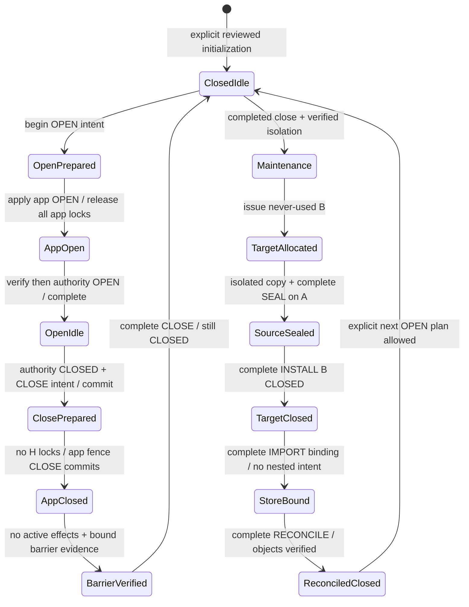

# PostgreSQL application migration design — Phase M2

Status: **DESIGN ONLY; M2-R1 source review corrections incorporated; pending external review. READY FOR M3: NO.** Section17 records independent review findings, adversarial schedules and mandatory validation blockers. No commit is authorized or performed by this document.

Repository: AmerZakret/Language-Coach. Design base: `20fa2ac63942646d939605453d40b93c0c9270b9`; this merge contains completed C2 checkpoint `c28063007232a49961bb5fd0be0bfb6cf26229a1`, with the same content tree. Branch: local `migration/postgresql-primary`. M1 evidence: `.release-validation/migration-m1/REPORT.md`, read including its dependency and test appendices. No SQL/TypeScript below has been installed or executed. These fenced examples are a specification for future reviewed work, not application migrations or repository implementations.

## 1. Executive architecture decision

Use the already declared `pg` driver through explicit Nest repositories and an application transaction manager. Preserve public IDs, protocol 2, request hashes, receipt results, ownership and existing API shapes. Keep three operational domains:

1. **Application PostgreSQL:** all thirteen known Mongo collection families, normalized Community likes, application control/events and application schema/cutover metadata.
2. **Independent authority PostgreSQL:** existing issued IDs/state/revision/audit, effect permits/isolation and C2 object ledger; proposed coordinator intent/step records and internal operation bindings. A separate PostgreSQL service/cluster, volume, credentials, ownership, backup/WAL retention and restore authorization is required. Two logical databases on one physical cluster are insufficient.
3. **Private versioned object storage:** current provider/keys/versions/identity/permissions and backend-authenticated routes retained. No automatic orphan cleanup, version purge or filesystem-to-S3 migration.

An application rollback must never roll back the authority to agree with it. No cross-database FK, FDW, dblink, distributed transaction, shared snapshot or combined restore operation is proposed. Existing anti-rollback remains CONDITIONAL; global stale-writer isolation and upload recovery remain PARTIAL. PostgreSQL technology does not establish HA, production capacity or global rate limiting. Phase 11B-D1 is not part of this work.

The initial PG writer design retains the current globally contended application fence. It trades optimistic Mongo conflicts for bounded row-lock waits; it is not a concurrency optimization. The cross-store coordinator is split into durable phases and **never holds an authority lock while waiting for application work**. C2 delete-intent authorization can therefore remain inside the owner-validated application transaction. Separate connection capacity and nonlocking object-reference reads prevent a corresponding pool cycle. Sections 6–7 define the protocol and its review gates.

Default conversion plan: offline conversion of an explicitly authorized consistent Mongo backup, preserving originals and all receipts. No existing data is declared disposable. A conservative **fresh B lineage** is the default for a real conversion, with old receipts still A; continuity-A is an exception requiring proof that no acknowledged application/receipt history was lost and explicit approval of the nonempty cutover protocol. Neither option is authorized for execution in M2.

### 1.1 Source evidence and M1 refinements

Source paths below are relative to the repository root. Current schemas: `lingua_ai_backend/src/{users,lessons,progress,flashcards,community,ai-coach}/schemas/`; the tenth model is `src/common/mutation-receipt.ts`. Native collections: `src/operations/timeline-contract.ts`, `src/tooling/{timeline-control,progress-audit}.ts`. DI/config: `src/{app.module,config/runtime-config}.ts`. All code references in later sections use `lingua_ai_backend/src/` unless another root is shown.

No collection discrepancy with M1 was found. Refinements from reinspection:

- `tooling/restore-consistency.ts:RESTORE_COLLECTIONS` excludes `progressauditrepairs` and lists ten domain collections; control is checked separately. Future whole-backup inventory must explicitly include all thirteen families and unexpected actual collections.
- M1's generic row-lock proposal is incomplete without replacing `AuthorityOperator.exclusive` around cross-store work (`tooling/durable-control.ts:175,251`). The new intent protocol is a required M4 change, not existing C1 behavior.
- The C2 operation mismatch is confirmed: `common/mutation-receipt.ts` accepts 1–128-character keys; authority `objects.delete_operation` and `object_record` use UUID; `tooling/object-effects-cli.ts` additionally requires v4 syntax. Section 9 specifies an internal binding without narrowing public keys or rewriting legacy ledger entries.
- `flashcards/services/srs-calculator.service.ts` uses JavaScript `Date.setDate`, which depends on the backend timezone/calendar. UTC timestamp storage must **not** replace that algorithm with SQL `now()+interval 'days'` during migration. Preserve configured process timezone and test DST boundaries; any algorithm change needs separate review.
- Read predicates use `targetLanguageQuery` regex aliases while display/XP mapping uses `tryTargetLanguage`. M1's suggested normalized read projection needs exact regex-membership validation; do not assume locale lowercasing or the display helper proves equivalence for every Unicode case/whitespace form. This is a design refinement, not a measured existing query failure.
- Required schema fields and declared defaults are not proof of legacy data completeness. This design retains presence metadata and blocks import acceptance on unexplained constraints/reference failures; it never fills historical award/timeline provenance.
- M1 treated NUL-containing text as a conversion exception. BSON string **values** can legally contain NUL while PostgreSQL text/JSONB cannot. Section3.7 defines a reversible payload-string codec so source-valid NUL/backslash values are preserved rather than excluded or silently stripped. This is a refinement of the preliminary representation, not evidence of actual NUL records in a backup.

## 2. Mongo collection-to-table and field mapping

There are **13 source collection families → 14 application model/control tables** because likes split from posts. Three operational tables bring the application total to **17**. Four proposed authority extension tables are separate: coordination intents/steps, operation bindings and independent authority schema history. The existing ten authority tables are retained, not counted as migrated Mongo collections.

| Source collection | Target table | Owner / lifecycle |
|---|---|---|
| users | lc_app.users | Users/Auth; no account deletion API; user references RESTRICT |
| lessons | lc_app.lessons | Reviewed operator catalog; logical lesson IDs retained; no startup seeding |
| progresses | lc_app.progresses | Progress; explicit owner reset deletes rows transactionally |
| progressresets | lc_app.progress_resets | Permanent reset receipts; no cascade/TTL |
| flashcards | lc_app.flashcards | Owner create/update/review/delete; receipts survive card deletion |
| flashcardoperations | lc_app.flashcard_operations | Permanent keyed resource/tombstone receipts |
| communityposts | lc_app.community_posts + lc_app.community_likes | Posts/reactions; explicit post delete cascades membership only |
| mutationreceipts | lc_app.mutation_receipts | Permanent frozen Community/AI results |
| chatmessages | lc_app.chat_messages | Explicit owner/language clear only; no automatic retention |
| chatbarriers | lc_app.chat_barriers | Owner/language send-clear ordering; survives clear |
| timelinecontrol | lc_app.application_timeline_control | Application restore domain, not independent authority |
| timelinecontrolevents | lc_app.application_timeline_events | Operator append-only history; same-event retry |
| progressauditrepairs | lc_app.progress_audit_repairs | Legacy audit/rollback evidence; target mutation tools remain disabled |
| New operational metadata, no source collection | lc_meta.database_identity; lc_meta.schema_migrations; lc_meta.cutover_receipts | Explicit provisioning/schema history and immutable conversion/cutover evidence |

### 2.1 Common field rules

For ten modeled collections and `progressauditrepairs`, `_id:ObjectId` maps to `id:lc_app.object_id` with exact lowercase hex. In the ten modeled collections, `__v` maps to nullable `document_version`; the native repair writer does not declare a version key. Native control `_id`/singleton both map to checked `singleton='global'`; native event `_id` maps to UUID `event_id`. Reject mismatched source `_id`/singleton, do not normalize a corrupt row.

**R1 typed-reference rule:** equality of printed hex is not equality of Mongo BSON types. Progress.userId, ProgressReset.userId, Flashcard.userId, FlashcardOperation.userId/resourceId, ChatMessage.userId and native repair.userId are ObjectId-typed paths; schema-backed queries cast parameters to ObjectId and can exclude a stored BSON string with the same spelling. CommunityPost.userId/likes entries, MutationReceipt.userId and ChatBarrier.userId are exact string paths. The converter must verify the original type and source query membership for each path. A string in an ObjectId-typed owner path is not automatically admitted because its hex resolves to a user: preserve typed raw evidence and block conversion pending an explicit visibility/ownership disposition. Conversely do not convert string-path owners into newly case-folded identities. No FK is a justification to activate previously invisible rows or change an owner. Logical lesson IDs also retain exact source String type/equality. Actual malformed/type-drift rows are unknown until authorized backup inventory.

For timestamped models, `createdAt/updatedAt` map to `created_at/updated_at timestamptz(3)`. Chat barriers have no source timestamps. Repair receipts have their own timestamps; control/events have explicit dates. No absent source timestamp is replaced by conversion time.

Every modeled target row carries `legacy_meta` with this **new internal**, versioned shape:

```json
{"v":1,"absent":["targetLanguage"],"null":[],"bsonTypes":{},"defaultProjection":[]}
```

`absent` and `null` are disjoint exact source field names, including `__v`/timestamps where relevant. `bsonTypes` records a reviewed exceptional original representation; it is not permission to accept malformed ownership. `defaultProjection` records only the evidence for read-time Mongoose-compatible defaults, never fabricated persisted provenance. Nested JSON retains nested omission/order itself. Unknown fields are retained in the immutable raw export and require explicit mapping/disposition; they are not silently stuffed into metadata. JSONB top-level metadata shape is checked in SQL; deep metadata consistency is validated by converter/serializers. New writers maintain presence entries for fields they set/unset.

Default clauses in SQL apply to **new inserts only**. The converter always lists every column and passes SQL NULL explicitly for missing/explicit-null source values, plus metadata. A hydrated-read serializer may project a documented default for an absent field; a lean-read serializer may omit it. Explicit null is never silently treated as missing. This preserves handler-specific Mongoose behavior; the golden corpus must capture hydrated/lean/toObject results, not just TypeScript types. Required source fields missing/null normally block admission; documented legacy-compatible read paths are explicit exceptions (for example lesson level/order, card/progress language). There is no generic backfill or permission to apply defaults to explicit null.

### 2.2 Explicit per-collection field map

Common `_id/__v/createdAt/updatedAt/legacy_meta` rules above apply wherever present; the following lists every declared domain field and native maintenance field.

| Source | Mongo fields → PostgreSQL columns |
|---|---|
| users | name→name; email→email; passwordHash→password_hash; isGuest→is_guest; level→stored_level; totalXp→total_xp; progressEpoch→progress_epoch; progressWriteRevision→progress_write_revision; streak→streak; targetLanguage→target_language; xpPerLanguage→xp_per_language; levelPerLanguage→level_per_language |
| lessons | id→lesson_id (**not** SQL document PK); targetLanguage→target_language; title→title; description→description; category→category; difficulty→difficulty; level→level; order→sort_order; duration→duration; xpReward→xp_reward; questions→questions |
| progresses | userId→user_id; lessonId→lesson_id; status→status; score→score; targetLanguage→target_language; awardedXp→awarded_xp; progressEpoch→progress_epoch |
| progressresets | userId→user_id; operationId→operation_id; expectedEpoch→expected_epoch; progressEpoch→progress_epoch; dataTimelineId→data_timeline_id |
| flashcards | userId→user_id; targetWord→target_word; turkishTranslation→turkish_translation; targetLanguage→target_language; nativeLanguage→native_language; nativeTranslation→native_translation; exampleSentence→example_sentence; note→note; interval→review_interval; easinessFactor→easiness_factor; nextReviewDate→next_review_date; reviewCount→review_count; history→history; aiContext→ai_context |
| flashcardoperations | userId→user_id; operationId→operation_id; operationType→operation_type; requestHash→request_hash; resourceId→resource_id; dataTimelineId→data_timeline_id |
| communityposts | userId→user_id; userName→stored_user_name; learningLanguage→learning_language; text→body_text; imageUrl→image_url; revision→revision; likes[]→community_likes(user_id,ordinal), parent post_id; likesCount→COUNT of membership rows (original count retained in source manifest and must match) |
| mutationreceipts | userId→user_id; operationType→operation_type; operationId→operation_id; requestHash→request_hash; result→result; dataTimelineId→data_timeline_id |
| chatmessages | userId→user_id; targetLanguage→target_language; role→role; message→message |
| chatbarriers | userId→user_id; targetLanguage→target_language; revision→revision |
| timelinecontrol | _id/singleton→singleton; dataTimelineId→data_timeline_id; writeState→write_state; controlVersion→control_version; fenceVersion→fence_version; createdAt→created_at; updatedAt→updated_at; lastEventId→last_event_id; sourceTimelineId→source_timeline_id. New authority_revision_floor/last_intent_id are operator-protocol metadata, never substituted source history |
| timelinecontrolevents | _id→event_id; request→request; previousTimelineId→previous_timeline_id; resultVersion→result_version; resultState→result_state; timestamp→recorded_at. action/target_timeline_id are lossless indexed projections of request |
| progressauditrepairs | _id→id; type→repair_type; userId→user_id; status→status; auditedAt→audited_at_text; appliedAt→applied_at; progressEpoch→progress_epoch; progressWriteRevision→progress_write_revision; languageLevelsAbsent→language_levels_absent; beforeFingerprint→before_fingerprint; afterFingerprint→after_fingerprint; fields→fields; before→before_state; after→after_state; rolledBackAt→rolled_back_at |

No Course, standalone Quiz, WritingAssessment, PronunciationResult, DailyActivity or general AIExercise collection exists in current evidence. Do not create those domains during persistence migration. Writing/pronunciation remain stateless apart from authenticated owner lookup; streak remains an existing user value.

## 3. Target SQL schema

The following is **proposed schema DDL inside documentation**. It has not been parsed/executed by PostgreSQL and is not an executable migration file. PostgreSQL 17 semantics are the baseline. SQL storage accepts valid historical values more broadly than current HTTP DTO limits where appropriate; new writes must retain existing validation. Invalid historical rows remain preserved outside the admitted runtime dataset until reviewed.

### 3.1 Domains and naming

```sql
CREATE SCHEMA lc_app;
CREATE SCHEMA lc_meta;
REVOKE ALL ON SCHEMA lc_app, lc_meta FROM PUBLIC;

CREATE DOMAIN lc_app.object_id AS text COLLATE "C"
  CHECK (VALUE ~ '^[0-9a-f]{24}$');
CREATE DOMAIN lc_app.safe_uint AS bigint
  CHECK (VALUE BETWEEN 0 AND 9007199254740991);
CREATE DOMAIN lc_app.control_counter AS bigint
  CHECK (VALUE BETWEEN 0 AND 9007199254740990);
CREATE DOMAIN lc_app.timeline_uuid AS uuid
  CHECK (VALUE::text ~ '^[0-9a-f]{8}-[0-9a-f]{4}-4[0-9a-f]{3}-[89ab][0-9a-f]{3}-[0-9a-f]{12}$');
CREATE DOMAIN lc_app.sha256 AS text COLLATE "C"
  CHECK (VALUE ~ '^[0-9a-f]{64}$');
CREATE DOMAIN lc_app.operation_id AS text COLLATE "C"
  CHECK (VALUE ~ '^[A-Za-z0-9._:-]{1,128}$');
CREATE DOMAIN lc_app.finite_float AS double precision
  CHECK (VALUE > '-Infinity'::double precision AND VALUE < 'Infinity'::double precision);
CREATE DOMAIN lc_app.metadata AS jsonb
  CHECK ((jsonb_typeof(VALUE)='object' AND VALUE->'v'='1'::jsonb
    AND jsonb_typeof(VALUE->'absent')='array'
    AND jsonb_typeof(VALUE->'null')='array'
    AND jsonb_typeof(VALUE->'bsonTypes')='object'
    AND jsonb_typeof(VALUE->'defaultProjection')='array') IS TRUE);
```

All identifiers/equality keys use binary deterministic C collation, not citext or locale-dependent case folding. Nullable scalar domains intentionally allow SQL NULL; table NOT NULL is explicit. The metadata CHECK uses `IS TRUE` so a missing required JSON member fails instead of passing a CHECK on SQL UNKNOWN; all metadata columns are NOT NULL. Other JSON shape checks operate on NOT NULL columns or explicitly permit SQL NULL.

### 3.2 Modeled application tables

```sql
CREATE TABLE lc_app.users (
  id lc_app.object_id CONSTRAINT users_pk PRIMARY KEY,
  name text NOT NULL CHECK (length(name)>0),
  email text COLLATE "C" NOT NULL CHECK (length(email)>0),
  password_hash text NOT NULL CHECK (length(password_hash)>0),
  is_guest boolean DEFAULT false,
  stored_level text DEFAULT 'Beginner',
  total_xp lc_app.safe_uint DEFAULT 0,
  progress_epoch lc_app.safe_uint DEFAULT 0,
  progress_write_revision lc_app.safe_uint DEFAULT 0,
  streak lc_app.safe_uint DEFAULT 0,
  target_language text DEFAULT 'en',
  xp_per_language jsonb DEFAULT '{}'::jsonb
    CHECK (xp_per_language IS NULL OR jsonb_typeof(xp_per_language)='object'),
  level_per_language jsonb DEFAULT '{}'::jsonb
    CHECK (level_per_language IS NULL OR jsonb_typeof(level_per_language)='object'),
  document_version lc_app.safe_uint DEFAULT 0,
  created_at timestamptz(3) DEFAULT clock_timestamp(),
  updated_at timestamptz(3) DEFAULT clock_timestamp(),
  legacy_meta lc_app.metadata NOT NULL DEFAULT
    '{"v":1,"absent":[],"null":[],"bsonTypes":{},"defaultProjection":[]}',
  CONSTRAINT users_email_uq UNIQUE (email)
);

CREATE TABLE lc_app.lessons (
  id lc_app.object_id CONSTRAINT lessons_pk PRIMARY KEY,
  lesson_id text COLLATE "C" NOT NULL CHECK (length(lesson_id)>0),
  target_language text NOT NULL,
  language_key text CHECK (language_key IN ('en','de','es','fr','ar')),
  title text NOT NULL, description text NOT NULL, category text NOT NULL,
  difficulty text NOT NULL, level text,
  sort_order lc_app.finite_float,
  duration lc_app.finite_float NOT NULL,
  xp_reward lc_app.safe_uint NOT NULL,
  questions jsonb DEFAULT '[]'::jsonb
    CHECK (questions IS NULL OR jsonb_typeof(questions)='array'),
  document_version lc_app.safe_uint DEFAULT 0,
  created_at timestamptz(3) DEFAULT clock_timestamp(),
  updated_at timestamptz(3) DEFAULT clock_timestamp(),
  legacy_meta lc_app.metadata NOT NULL DEFAULT
    '{"v":1,"absent":[],"null":[],"bsonTypes":{},"defaultProjection":[]}',
  CONSTRAINT lessons_logical_id_uq UNIQUE (lesson_id)
);

CREATE TABLE lc_app.progresses (
  id lc_app.object_id CONSTRAINT progresses_pk PRIMARY KEY,
  user_id lc_app.object_id NOT NULL REFERENCES lc_app.users(id) ON DELETE RESTRICT,
  lesson_id text COLLATE "C" NOT NULL REFERENCES lc_app.lessons(lesson_id) ON DELETE RESTRICT,
  status text DEFAULT 'completed',
  score lc_app.finite_float NOT NULL,
  target_language text,
  language_key text CHECK (language_key IN ('en','de','es','fr','ar')),
  awarded_xp lc_app.safe_uint,
  progress_epoch lc_app.safe_uint,
  document_version lc_app.safe_uint DEFAULT 0,
  created_at timestamptz(3) DEFAULT clock_timestamp(),
  updated_at timestamptz(3) DEFAULT clock_timestamp(),
  legacy_meta lc_app.metadata NOT NULL DEFAULT
    '{"v":1,"absent":[],"null":[],"bsonTypes":{},"defaultProjection":[]}',
  CONSTRAINT progresses_owner_lesson_uq UNIQUE (user_id,lesson_id)
);

CREATE TABLE lc_app.progress_resets (
  id lc_app.object_id CONSTRAINT progress_resets_pk PRIMARY KEY,
  user_id lc_app.object_id NOT NULL REFERENCES lc_app.users(id) ON DELETE RESTRICT,
  operation_id lc_app.operation_id NOT NULL,
  expected_epoch lc_app.safe_uint NOT NULL,
  progress_epoch lc_app.safe_uint NOT NULL,
  data_timeline_id lc_app.timeline_uuid,
  document_version lc_app.safe_uint DEFAULT 0,
  created_at timestamptz(3) DEFAULT clock_timestamp(),
  updated_at timestamptz(3) DEFAULT clock_timestamp(),
  legacy_meta lc_app.metadata NOT NULL DEFAULT
    '{"v":1,"absent":[],"null":[],"bsonTypes":{},"defaultProjection":[]}',
  CONSTRAINT progress_resets_owner_op_uq UNIQUE (user_id,operation_id),
  CONSTRAINT progress_resets_increment_ck CHECK (progress_epoch=expected_epoch+1)
);

CREATE TABLE lc_app.flashcards (
  id lc_app.object_id CONSTRAINT flashcards_pk PRIMARY KEY,
  user_id lc_app.object_id NOT NULL REFERENCES lc_app.users(id) ON DELETE RESTRICT,
  target_word text COLLATE "C" NOT NULL,
  turkish_translation text NOT NULL,
  target_language text COLLATE "C",
  language_key text CHECK (language_key IN ('en','de','es','fr','ar')),
  native_language text, native_translation text, example_sentence text, note text,
  review_interval lc_app.finite_float DEFAULT 0,
  easiness_factor lc_app.finite_float DEFAULT 2.5,
  next_review_date timestamptz(3) DEFAULT clock_timestamp(),
  review_count lc_app.safe_uint DEFAULT 0,
  history jsonb DEFAULT '[]'::jsonb CHECK (history IS NULL OR jsonb_typeof(history)='array'),
  ai_context jsonb,
  document_version lc_app.safe_uint DEFAULT 0,
  created_at timestamptz(3) DEFAULT clock_timestamp(),
  updated_at timestamptz(3) DEFAULT clock_timestamp(),
  legacy_meta lc_app.metadata NOT NULL DEFAULT
    '{"v":1,"absent":[],"null":[],"bsonTypes":{},"defaultProjection":[]}',
  CONSTRAINT flashcards_owner_raw_word_uq
    UNIQUE NULLS NOT DISTINCT (user_id,target_language,target_word)
);

CREATE TABLE lc_app.flashcard_operations (
  id lc_app.object_id CONSTRAINT flashcard_operations_pk PRIMARY KEY,
  user_id lc_app.object_id NOT NULL REFERENCES lc_app.users(id) ON DELETE RESTRICT,
  operation_id lc_app.operation_id NOT NULL,
  operation_type text COLLATE "C" NOT NULL CHECK (operation_type IN
    ('create-flashcard','update-flashcard','delete-flashcard','review-flashcard')),
  request_hash lc_app.sha256 NOT NULL,
  resource_id lc_app.object_id NOT NULL,
  data_timeline_id lc_app.timeline_uuid,
  document_version lc_app.safe_uint DEFAULT 0,
  created_at timestamptz(3) DEFAULT clock_timestamp(),
  updated_at timestamptz(3) DEFAULT clock_timestamp(),
  legacy_meta lc_app.metadata NOT NULL DEFAULT
    '{"v":1,"absent":[],"null":[],"bsonTypes":{},"defaultProjection":[]}',
  CONSTRAINT flashcard_operations_identity_uq UNIQUE (user_id,operation_id,operation_type)
);

CREATE TABLE lc_app.community_posts (
  id lc_app.object_id CONSTRAINT community_posts_pk PRIMARY KEY,
  user_id lc_app.object_id NOT NULL REFERENCES lc_app.users(id) ON DELETE RESTRICT,
  stored_user_name text NOT NULL,
  learning_language text NOT NULL,
  language_key text CHECK (language_key IN ('en','de','es','fr','ar')),
  body_text text, image_url text,
  revision lc_app.safe_uint DEFAULT 0,
  document_version lc_app.safe_uint DEFAULT 0,
  created_at timestamptz(3) DEFAULT clock_timestamp(),
  updated_at timestamptz(3) DEFAULT clock_timestamp(),
  legacy_meta lc_app.metadata NOT NULL DEFAULT
    '{"v":1,"absent":[],"null":[],"bsonTypes":{},"defaultProjection":[]}',
  CONSTRAINT community_posts_content_ck
    CHECK (coalesce(length(body_text),0)>0 OR coalesce(length(image_url),0)>0)
);

CREATE TABLE lc_app.community_likes (
  post_id lc_app.object_id NOT NULL REFERENCES lc_app.community_posts(id) ON DELETE CASCADE,
  user_id lc_app.object_id NOT NULL REFERENCES lc_app.users(id) ON DELETE RESTRICT,
  ordinal lc_app.safe_uint NOT NULL,
  CONSTRAINT community_likes_pk PRIMARY KEY (post_id,user_id),
  CONSTRAINT community_likes_order_uq UNIQUE (post_id,ordinal)
);

CREATE TABLE lc_app.mutation_receipts (
  id lc_app.object_id CONSTRAINT mutation_receipts_pk PRIMARY KEY,
  user_id lc_app.object_id NOT NULL REFERENCES lc_app.users(id) ON DELETE RESTRICT,
  operation_type text COLLATE "C" NOT NULL CHECK (operation_type IN
    ('community-create','community-update','community-delete','community-reaction','ai-send','ai-clear')),
  operation_id lc_app.operation_id NOT NULL,
  request_hash lc_app.sha256 NOT NULL,
  result jsonb,
  data_timeline_id lc_app.timeline_uuid,
  document_version lc_app.safe_uint DEFAULT 0,
  created_at timestamptz(3) DEFAULT clock_timestamp(),
  updated_at timestamptz(3) DEFAULT clock_timestamp(),
  legacy_meta lc_app.metadata NOT NULL DEFAULT
    '{"v":1,"absent":[],"null":[],"bsonTypes":{},"defaultProjection":[]}',
  CONSTRAINT mutation_receipts_identity_uq UNIQUE (user_id,operation_type,operation_id)
);

CREATE TABLE lc_app.chat_messages (
  id lc_app.object_id CONSTRAINT chat_messages_pk PRIMARY KEY,
  user_id lc_app.object_id NOT NULL REFERENCES lc_app.users(id) ON DELETE RESTRICT,
  target_language text NOT NULL,
  language_key text CHECK (language_key IN ('en','de','es','fr','ar')),
  role text NOT NULL CHECK (role IN ('user','assistant')),
  message text NOT NULL,
  document_version lc_app.safe_uint DEFAULT 0,
  created_at timestamptz(3) DEFAULT clock_timestamp(),
  updated_at timestamptz(3) DEFAULT clock_timestamp(),
  legacy_meta lc_app.metadata NOT NULL DEFAULT
    '{"v":1,"absent":[],"null":[],"bsonTypes":{},"defaultProjection":[]}'
);

CREATE TABLE lc_app.chat_barriers (
  id lc_app.object_id CONSTRAINT chat_barriers_pk PRIMARY KEY,
  user_id lc_app.object_id NOT NULL REFERENCES lc_app.users(id) ON DELETE RESTRICT,
  target_language text COLLATE "C" NOT NULL,
  revision lc_app.safe_uint DEFAULT 0,
  document_version lc_app.safe_uint DEFAULT 0,
  legacy_meta lc_app.metadata NOT NULL DEFAULT
    '{"v":1,"absent":[],"null":[],"bsonTypes":{},"defaultProjection":[]}',
  CONSTRAINT chat_barriers_owner_language_uq UNIQUE (user_id,target_language)
);
```

Missing/null raw flashcard language maps to one Mongo-compatible unique slot through NULLS NOT DISTINCT; `legacy_meta` still preserves the distinction for query/response semantics. This full unique key never uses normalized `language_key`. There is no obsolete owner/word unique constraint. Owner references originally stored as strings in Community/receipts/barriers now use the same checked ID domain, **only after backup inventory verifies attributable references**. Invalid/orphan historical owners are not reassigned or deleted to satisfy the FK.

**R1 legacy field compatibility:** `lessons/lessons.service.ts` deliberately sorts unknown/missing level at weight99 and missing/null/zero order using `(order || 0)`. Therefore level/sort_order are nullable for imported absence/null and retain presence metadata; list/get responses preserve lean omission/null and sort after decoding. New operator catalog writes still require valid level/order by the current schema/content validation; SQL NULL support does not make them optional new inputs. Do not add a progress snapshot `status='completed'` predicate: the current service includes all matching progress rows regardless of stored status.

`Flashcard.aiContext` uses a loose Object/Mixed persistence type, while `AiContextService.generateContext` checks required sentences/mnemonic then returns the entire provider object, including additional members. Store valid historical JSON of any shape in ai_context without coercing primitives/arrays to object or deleting members. New provider writes retain the existing required-member checks and preserve additional JSON members under resource bounds; this field never supplies owner/identity/SRS/provenance. Flexible JSON is isolated from relational invariants. Unknown non-JSON BSON content still requires explicit conversion disposition. This removes the draft's unnecessarily narrower SQL object-only CHECK.

Receipts intentionally have no live-resource FK: deleted cards/posts and cleared messages must remain replayable. `result` SQL NULL can preserve a genuinely missing imported field; JSON literal null is distinct. New runtime results must be complete before commit. No receipt key contains timeline as a uniqueness component.

### 3.3 Application control and legacy maintenance evidence

```sql
CREATE TABLE lc_app.application_timeline_events (
  event_id lc_app.timeline_uuid CONSTRAINT application_timeline_events_pk PRIMARY KEY,
  request jsonb NOT NULL CHECK (jsonb_typeof(request)='object'),
  action text NOT NULL CHECK (action IN ('initialize','close','install-timeline','open','bind-cutover')),
  target_timeline_id lc_app.timeline_uuid NOT NULL,
  previous_timeline_id lc_app.timeline_uuid,
  result_version lc_app.control_counter NOT NULL,
  result_state text NOT NULL CHECK (result_state IN ('OPEN','CLOSED')),
  recorded_at timestamptz(3) NOT NULL,
  intent_id uuid,
  authority_revision lc_app.control_counter,
  legacy_meta lc_app.metadata NOT NULL DEFAULT
    '{"v":1,"absent":[],"null":[],"bsonTypes":{},"defaultProjection":[]}',
  CONSTRAINT application_event_projection_ck CHECK
    ((request->>'eventId'=event_id::text
      AND request->>'targetTimelineId'=target_timeline_id::text
      AND request->>'action'=action) IS TRUE)
);

CREATE TABLE lc_app.application_timeline_control (
  singleton text CONSTRAINT application_timeline_control_pk PRIMARY KEY CHECK (singleton='global'),
  data_timeline_id lc_app.timeline_uuid NOT NULL,
  write_state text NOT NULL CHECK (write_state IN ('OPEN','CLOSED')),
  control_version lc_app.control_counter NOT NULL,
  fence_version lc_app.control_counter NOT NULL,
  created_at timestamptz(3) NOT NULL,
  updated_at timestamptz(3) NOT NULL,
  last_event_id lc_app.timeline_uuid NOT NULL REFERENCES lc_app.application_timeline_events(event_id) ON DELETE RESTRICT,
  source_timeline_id lc_app.timeline_uuid,
  authority_revision_floor lc_app.control_counter NOT NULL DEFAULT 0,
  last_intent_id uuid
);

CREATE TABLE lc_app.progress_audit_repairs (
  id lc_app.object_id CONSTRAINT progress_audit_repairs_pk PRIMARY KEY,
  repair_type text NOT NULL CHECK (repair_type='derived-level-repair'),
  user_id lc_app.object_id NOT NULL REFERENCES lc_app.users(id) ON DELETE RESTRICT,
  status text NOT NULL CHECK (status IN ('applied','rolled-back')),
  audited_at_text text NOT NULL,
  applied_at timestamptz(3) NOT NULL,
  progress_epoch lc_app.safe_uint NOT NULL,
  progress_write_revision lc_app.safe_uint,
  language_levels_absent boolean NOT NULL,
  before_fingerprint lc_app.sha256 NOT NULL,
  after_fingerprint lc_app.sha256 NOT NULL,
  fields jsonb NOT NULL CHECK (jsonb_typeof(fields)='array'),
  before_state jsonb NOT NULL CHECK (jsonb_typeof(before_state)='object'),
  after_state jsonb NOT NULL CHECK (jsonb_typeof(after_state)='object'),
  rolled_back_at timestamptz(3),
  legacy_meta lc_app.metadata NOT NULL DEFAULT
    '{"v":1,"absent":[],"null":[],"bsonTypes":{},"defaultProjection":[]}'
);
```

Control history inserts before its referencing singleton update in the same transaction. The singleton PK makes a second row impossible; exactly **one** valid row is additionally a readiness/operator invariant. Control remains absent until explicit initialization/import. No implicit default 'global'/OPEN or generated timeline. Events preserve the exact public request object including optional-field presence. A new private `bind-cutover` action binds an already CLOSED imported control without fabricating a source timeline transition; it cannot open, issue a UUID or relabel receipts.

Repair fingerprints remain original Mongo EJSON-domain evidence, not SQL row hashes. No PG repair/apply/rollback functionality is enabled by this schema. Retain the raw `before/after/fields` evidence, including absence markers. Account deletion remains unsupported; no new soft-delete feature is introduced.

### 3.4 Application operational metadata

```sql
CREATE TABLE lc_meta.database_identity (
  singleton boolean CONSTRAINT database_identity_pk PRIMARY KEY CHECK (singleton),
  environment text NOT NULL CHECK (environment ~ '^[a-z][a-z0-9._-]{0,63}$'),
  storage_identity text NOT NULL CHECK (storage_identity ~ '^[a-z][a-z0-9._-]{0,95}$'),
  database_instance_id lc_app.timeline_uuid NOT NULL,
  created_at timestamptz(3) NOT NULL,
  CONSTRAINT database_instance_id_uq UNIQUE (database_instance_id)
);

CREATE TABLE lc_meta.schema_migrations (
  migration_id text COLLATE "C" CONSTRAINT schema_migrations_pk PRIMARY KEY
    CHECK (migration_id ~ '^[0-9]{4}_[a-z0-9_]+$'),
  ordinal integer NOT NULL CHECK (ordinal>0),
  file_sha256 lc_app.sha256 NOT NULL,
  manifest_sha256 lc_app.sha256 NOT NULL,
  applied_at timestamptz(3) NOT NULL,
  applied_by text NOT NULL,
  runner_version text NOT NULL,
  CONSTRAINT schema_migrations_order_uq UNIQUE (ordinal)
);

CREATE TABLE lc_meta.cutover_receipts (
  event_id lc_app.timeline_uuid CONSTRAINT cutover_receipts_pk PRIMARY KEY,
  intent_id uuid NOT NULL,
  source_engine text NOT NULL CHECK (source_engine IN ('mongodb','postgresql')),
  source_backup_sha256 lc_app.sha256 NOT NULL,
  source_inventory_sha256 lc_app.sha256 NOT NULL,
  target_inventory_sha256 lc_app.sha256 NOT NULL,
  schema_manifest_sha256 lc_app.sha256 NOT NULL,
  object_inventory_sha256 lc_app.sha256 NOT NULL,
  target_storage_identity text NOT NULL,
  authority_environment text NOT NULL,
  authority_storage_identity text NOT NULL,
  target_timeline_id lc_app.timeline_uuid NOT NULL,
  authority_generation lc_app.control_counter NOT NULL CHECK (authority_generation>0),
  app_control_version lc_app.control_counter NOT NULL,
  reference text NOT NULL CHECK (reference ~ '^[A-Za-z0-9._:/-]{1,96}$'),
  recorded_at timestamptz(3) NOT NULL,
  actor text NOT NULL
);
```

Identity is explicitly provisioned from a reviewed target manifest, not derived from restored application data. A restore copies the old row; mismatch with actual target volume/expected identity keeps readiness CLOSED until an explicit isolated rebind records independent intent/cutover evidence. This does not let application identity substitute for authority identity. Cutover receipts restore with the app; their digests and independent authority completion records must also be retained outside app backups.

### 3.5 Secondary indexes and integrity mechanisms

All PK/UNIQUE constraints above create their normal backing indexes. The following **12 explicit secondary indexes** are proposed; no GIN/full-text/generated-column index is needed for observed queries:

```sql
CREATE INDEX lessons_filter_idx ON lc_app.lessons(language_key,level,sort_order,id);
CREATE INDEX progresses_language_idx ON lc_app.progresses(user_id,language_key,lesson_id);
CREATE INDEX flashcards_due_idx ON lc_app.flashcards(user_id,next_review_date,id);
CREATE INDEX flashcards_alias_word_idx ON lc_app.flashcards(user_id,language_key,target_word,id);
CREATE INDEX community_feed_idx ON lc_app.community_posts(created_at DESC NULLS LAST,id DESC);
CREATE INDEX community_language_feed_idx ON lc_app.community_posts(language_key,created_at DESC NULLS LAST,id DESC);
CREATE INDEX community_image_idx ON lc_app.community_posts(image_url);
CREATE INDEX community_owner_idx ON lc_app.community_posts(user_id);
CREATE INDEX community_likes_owner_idx ON lc_app.community_likes(user_id,post_id);
CREATE INDEX chat_history_idx ON lc_app.chat_messages(user_id,language_key,created_at DESC NULLS LAST,id DESC);
CREATE INDEX control_events_target_idx ON lc_app.application_timeline_events(target_timeline_id,action);
CREATE INDEX progress_repairs_owner_idx ON lc_app.progress_audit_repairs(user_id,id);
```

Index needs are based on source queries, not measured plans. Existing standalone chat target-language/user indexes need not be mechanically duplicated when a useful owner-prefixed history index covers observed access. SQL PK/UNIQUE constraints preserve nine critical Mongo uniqueness invariants; the singleton PK subsumes redundant unique singleton. No partial/sparse/TTL substitute is allowed for application receipt/completion/card identities. Foreign-key access is covered by owner-prefixed unique/secondary indexes, including likes owner; source logical lesson lookup is unique.

PostgreSQL's [constraint semantics](https://www.postgresql.org/docs/17/ddl-constraints.html) are the reference for FK/unique/NULL behavior; the project-specific historical-data admission rules above are separate from database capability.

Exact proposed new backing-index count: **application 40 =17 PK +11 UNIQUE +12 secondary; authority extensions 10 =4 PK +3 UNIQUE +2 partial UNIQUE +1 secondary; total50**. Existing authority indexes are retained and excluded from these new-design counts. The two partial indexes protect pending intents and newly ALLOCATED internal UUIDs; neither is an application receipt constraint. NOT NULL/CHECK/FK clauses do not create additional backing indexes here. Feed/history queries explicitly use DESC NULLS LAST to preserve missing/null timestamp ordering rather than PostgreSQL's default DESC NULLS FIRST; source API tie/order fixtures remain required.

History protection is part of the schema specification: revoke UPDATE/DELETE/TRUNCATE from runtime on `progress_resets`, `flashcard_operations`, `mutation_receipts`, `application_timeline_events`, `progress_audit_repairs`, `lc_meta.schema_migrations` and `lc_meta.cutover_receipts`; install statement-level BEFORE UPDATE OR DELETE OR TRUNCATE rejection triggers on these **seven** tables. Function contract: always raise fixed `42501`, never include row data. Import/migration owner remains a trusted capability and must not disable protection during normal operations. Complete receipts are inserted once at end of the fenced transaction, eliminating runtime receipt patch privilege (section 5). This is an internal change, not a wire change.

No automatic timestamp update trigger: repositories explicitly set the same fields/timing as the corresponding source save/update. Import passes source timestamps. No stored generated level, derived XP total or normalized-language uniqueness. `language_key` is an internal read projection computed by a verified equivalent of the **actual Mongo alias-regex membership**, using source `common/target-language.ts:targetLanguageQuery` patterns/flags as evidence. Display/XP still use unchanged `tryTargetLanguage`; it is not automatically the query-membership implementation. Golden Mongo-engine alias/case/Unicode whitespace fixtures and each actual backup raw value must establish membership equivalence; ambiguity blocks conversion or requires the exact reviewed predicate, not silent case-folding. The key may be NULL for genuinely unmatched raw values and never replaces raw text. Runtime cannot accept client-supplied projection values.

### 3.6 JSONB structures and validation responsibilities

| Column | Expected structure / preservation | Validation |
|---|---|---|
| users.xp_per_language | Object keyed by exact original language spelling, finite nonnegative safe integer values | SQL object/null; deep converter and repository validation; new awards update canonical key only under owner lock; aliases sum as today |
| users.level_per_language | Object of exact raw keys to stored level strings | SQL object/null; deep application validation; no key merging/generated backfill |
| lessons.questions | Ordered objects `{id,question,options:string[],correctAnswer,type,_id?}` | SQL array/null; deep converter/new catalog validation; preserve embedded IDs and order; unknown historical members explicitly reviewed |
| flashcards.history | Ordered objects `{date:ISO milliseconds,score:finite number,_id?}` | SQL array/null; deep converter/writer validation; new review score 0..5 integer; historical schema permitted broader finite values, not silently changed |
| flashcards.ai_context | Normally `{sentences:string[],mnemonic:string,...additionalJSON}`; valid legacy JSON may have another shape | JSONB syntax/storage only; current provider required-member checks for new context, preserve extra JSON; legacy valid JSON shape is not silently rewritten. Owner/SRS/provenance remain separate constrained columns |
| mutation_receipts.result | Frozen JSON-compatible public result, possibly nested post/messages/URL/IDs | Exact source JSON round-trip semantics, type-aware canonical checksum. SQL JSONB syntax only; never derive requestHash from JSONB representation |
| application_timeline_events.request | Exact native control request incl. optional expected/source values and safe reference | SQL projection check + exact allowlist/type/range validation in operator function; semantic equality preserves absent optional keys |
| progress_audit_repairs.fields/before_state/after_state | Original FieldChange array and audited level/language snapshots | SQL top-level; deep raw-evidence validation by converter/audit tool; no lossy SQL fingerprint substitution |
| legacy_meta | Version/presence/type/default-projection metadata described above | Strict SQL required top-level members; deep allowlist/consistency in converter/serializer |

Avoid unbounded JSON aggregation in request paths; source documents/history/receipts can grow and require bounded transport/resource handling without deleting history. Binary BSON, NaN/Infinity, out-of-range numbers, unknown BSON and invalid dates are conversion exceptions, not implicit JSON strings. Source-valid NUL/backslash text uses section3.7 instead of quarantine. Section10 defines exceptions. Current HTTP/AI validation limits remain authoritative for new writes; they do not authorize retroactively deleting or clipping larger historical values.

### 3.7 Reversible source-string representation (LC-PG-TEXT-1)

PostgreSQL [character types](https://www.postgresql.org/docs/17/datatype-character.html) and [JSONB](https://www.postgresql.org/docs/17/datatype-json.html) exclude NUL. The [BSON specification](https://bsonspec.org/spec.html) distinguishes length-delimited string values from NUL-excluding cstring field names. Therefore source-valid payload strings must not be declared invalid merely to fit SQL.

For **all source payload text values**, encode each original backslash U+005C as two backslashes and each NUL U+0000 as backslash followed by the ASCII digit0; all other valid Unicode characters remain unchanged. Decode with a single left-to-right scan: two backslashes→one backslash, backslash+0→NUL, other unpaired/unknown escape→stored-data error/fail closed. Encoding is always applied once, even to strings without NUL, so a literal two-character backslash+0 cannot alias a NUL. No Unicode normalization, trimming, case folding or SQL quoting is performed by this codec.

Apply recursively to source-payload JSONB **string values and keys**, retaining object/array/numeric/null structure; decode before business/DTO/serializer/semantic-checksum use. Fixed schema/metadata keys remain literal. Scalar source text columns (including logical text keys/email/words/URLs) use the same injective codec in stored values **and query parameters**. Valid object IDs, operation keys, SHA values, UUID text and fixed protocol enums have no affected characters and remain identical. Operational manifests/checksum file bytes, binary backup bytes, roles and SQL identifiers are not payload strings and are not passed through the codec. `legacy_meta` is new schema metadata with fixed field-name vocabulary, not an opaque codec envelope.

R1 codec requirements: visit own data properties only, construct dictionaries with null prototype or equivalent safe property definition, preserve literal `__proto__`/`constructor`/`prototype` as inert JSON keys, and never spread decoded data into a principal/row/SQL-options object. Validate declared logical limits before encoding, and independently cap encoded bytes/depth/node count and converter batch memory; escaping can expand payloads. Decode exactly once under the schema manifest version. Dates/ObjectIds in known nested paths receive the field-aware public JSON conversion before this string codec, with original BSON evidence retained separately. No executable deserialization, getter invocation or heuristic raw/encoded detection. Invalid surrogate/BSON boundary behavior requires source golden fixtures; no speculative Unicode replacement is authorized.

The schema/migration manifest requires encodingVersion `LC-PG-TEXT-1`; no mixed raw/encoded rows or heuristically double-decoded data are allowed. Domain/type validation and current DTO length/range checks operate on decoded logical values; SQL shape/identity constraints operate on their stored representation. Complete result is frozen using the existing JSON round-trip **before** encoding; returned/replayed JSON is decoded, so API response values and original requestHash remain unchanged. Language query keys are computed before encoding using verified source predicates. Source Map values/keys are decoded before alias aggregation; canonical en/de/es/fr/ar JSON update paths are unaffected.

Encoded text preserves equality, **not arbitrary lexical ordering**. Source logical text sorting/filtering must use the specified decoded application sort or verified read projection; do not introduce SQL ORDER BY/regex/LIKE over encoded payload text and call it equivalent. Existing ordered SQL access uses numeric/order/time/ObjectId keys and verified language projections. Email/word/logical-ID uniqueness remains exact because encoding is injective and comparisons use C collation. The codec is not SQL-injection protection; values are still parameterized.

Golden/property tests must cover empty string, NUL, literal backslash+0, repeated/trailing backslashes, supplementary Unicode, slash-containing URLs, nested JSON keys/values, known receipt hashes/results and all ID/unique lookup boundaries. PG integration must prove exact round-trip of source-valid payloads and no raw NUL reaches a PostgreSQL text/JSONB parameter. Invalid UTF-8/BSON or unsupported numeric/type values still preserve raw evidence and block conversion. This codec is proposed documentation only; no helper was implemented/executed in M2.

## 4. Identifier and client/API compatibility

| Exposed/internal identity | Required behavior / evidence |
|---|---|
| User JWT sub and auth/profile `id` | Exact imported 24-hex ID; `auth/auth.service.ts`, `auth/jwt.strategy.ts`, `users/user-response.ts`; web `src/api/authApi.ts:parsePublicUser` explicitly validates shape |
| Authenticated principal | Supply internal `_id.toString()` and `id` access used by current controllers through an explicit principal adapter; serialize safe profile, never password_hash or raw DB row |
| Logical lesson/question IDs | Preserve lesson `id` separately from document `_id`; nested question IDs/order stay unchanged. Progress references logical lesson_id; no catalog regeneration |
| Flashcard/post/chat `_id`, embedded `_id`, `__v` | Preserve resource shapes and document_version/presence; Flutter models read `_id`; offline queues map returned `_id || id` to local dependent actions |
| Persisted owner strings/ObjectIds | Verify source BSON type/attribution before mapping to shared hex domain; no mapping by email, case coercion of arbitrary strings or account reassignment |
| Operation IDs/hashes | Original key exactly retained, including non-UUID text; SHA-256 hash algorithm/input omission unchanged. Globally unique owner/type/key, never per timeline |
| Guest/cache namespace | Backend guests remain independent users; `guest_<id>` and `registered_<id>` stable; local_guest has no server authority (`lingua_ai/lib/services/auth_service.dart`, web `utils/userKey.ts`) |
| Timeline, event/object UUIDs | Existing opaque canonical v4 lineage/issuance IDs and immutable object names/keys unchanged. Independent generation is not a client revision/epoch/local-slot generation |
| Internal C2 delete UUID | Preserve legacy ledger values; future opaque mapping in section 9 binds original owner/type/key without changing API key or receipt hash |

New Mongo-shaped resource IDs use a documented 12-byte generator without Mongo dependency. Choose **ObjectId-compatible ordering**: four-byte unsigned epoch-seconds, five process-random bytes, three-byte process counter with wrap/collision handling. Generate/reseed securely, retain counter across concurrent allocations, and never use time/ID order as authorization or timeline. If same-second cross-process order differs, explicit created_at then ID tie order remains deterministic as today. Retry a generated-ID PK collision before any externally committed resource/receipt; never retry another unique constraint as an ID collision. Do not casually choose fully random public IDs and assume historical tie ordering irrelevant; this refines M1's tentative random-ID option.

Preserve bcrypt cost 10/hash bytes and guest sentinel `!guest-no-password!`, isGuest isolation, exact-email lookup/case-sensitive uniqueness, 7-day JWT payload/key/claims and user existence reload. No refresh/session table is invented. SQL change alone does not authorize JWT key rotation or user-ID replacement. `progress/:userId` remains a compatibility route parameter while JWT owns the query. Existing auth/profile response fields and all status/header/error classes remain unchanged.

Incoming syntactically valid 24-hex **ObjectId parameters** may be case-insensitive and are canonicalized to lowercase exactly where Mongo currently casts an ObjectId. Do not apply that rule to logical lesson IDs, operation keys, or stored string owners: those remain exact strings, and a malformed/uppercase legacy string owner cannot be silently repaired into new ownership. Preserve existing 400/401/403/404 paths through endpoint-specific validation and lookup adapters.

SQL bigint decoding uses explicit per-column checked conversion to JS safe number; do not globally override parsers and expose bigint as JSON string. Parse timestamps as instants, emit the same ISO milliseconds and handler-specific omission. Source progress reads use a response-time fallback when createdAt is missing; preserve that serializer behavior without persisting import time. Preserve literal JSON null separately from SQL NULL/missing metadata. Frozen receipt result JSON equality is semantic (key order may differ) while stored request hash remains byte-for-byte original. Do not stringify/re-hash imported results to create new operation identity.

## 5. Repository and transaction architecture

### 5.1 Providers, transaction ownership and representative interfaces

Proposed future files: `src/persistence/{application-database,application-transaction,pg-errors,pg-row-mapping}.ts`, feature repository interfaces/adapters and explicit tooling migrations. These files **do not exist as M2 implementation**. Preserve public controllers/services and replace their model dependencies behind repository contracts in M3. `AppModule` owns one singleton application provider; no pool per request, repository or user. Authority provider remains separately configured; no client connection ever changes databases between roles.

Design interfaces (illustrative types, no implementations):

```ts
type ObjectIdString = string & { readonly objectIdBrand: unique symbol };
type TimelineId = string & { readonly timelineBrand: unique symbol };
type SafeCounter = number & { readonly safeCounterBrand: unique symbol };
interface Admission {
  readonly dataTimelineId: TimelineId;
  readonly protocol: 1 | 2;
  readonly legacyReceipts: boolean;
  readonly authorityGeneration: SafeCounter;
}
interface WriteTx { readonly transactionBrand: unique symbol }
interface ReadSnapshot { readonly snapshotBrand: unique symbol }
interface AppTransactions {
  write<T>(scope: Admission, domain: string,
    work: (tx: WriteTx) => Promise<T>): Promise<T>;
  snapshot<T>(work: (tx: ReadSnapshot) => Promise<T>): Promise<T>;
}
interface UsersRepository {
  findById(id: ObjectIdString): Promise<UserRecord | null>;
  findByEmailExact(email: string): Promise<UserRecord | null>;
  lock(tx: WriteTx, id: ObjectIdString): Promise<UserRecord | null>;
  insert(tx: WriteTx, input: NewUserRecord): Promise<UserRecord>;
  patchProfile(tx: WriteTx, id: ObjectIdString, patch: ProfilePatch): Promise<UserRecord>;
  applyProgress(tx: WriteTx, id: ObjectIdString, change: ProgressChange): Promise<UserRecord>;
}
interface ReceiptsRepository {
  get(tx: WriteTx, key: ReceiptIdentity): Promise<ReceiptRecord | null>;
  insertComplete(tx: WriteTx, receipt: CompleteReceipt): Promise<void>;
}
interface ProgressRepository {
  getSnapshot(tx: ReadSnapshot, owner: ObjectIdString, language?: string): Promise<ProgressView>;
  findCompletion(tx: WriteTx, owner: ObjectIdString, lessonId: string): Promise<CompletionRecord | null>;
  insertCompletion(tx: WriteTx, row: NewCompletion): Promise<void>;
  improveScore(tx: WriteTx, id: ObjectIdString, score: number): Promise<void>;
  deleteOwnerCompletions(tx: WriteTx, owner: ObjectIdString): Promise<void>;
}
interface ImageReferences {
  // Primary nonlocking SELECT on a reserved read connection; no authority lock.
  existsCurrent(url: string): Promise<boolean>;
  inventoryClosed(snapshot: ReadSnapshot, afterId?: ObjectIdString): Promise<ImageReferencePage>;
}
interface ControlRepository {
  discover(): Promise<ControlRecord | null>;
  // Accessible only to transaction manager; SQL permission via narrow function.
  lockAndTouch(tx: WriteTx, scope: Admission): Promise<ControlRecord>;
}
```

Named value types above (`UserRecord`, `ProfilePatch`, etc.) are DTO/row specifications to define during M3 from the field map; they are not current repository exports. Further required contracts: LessonsRepository(read logical ID/filter/catalog-only write), CardsRepository(owner lock/create/update/delete/review/due/all), FlashcardOperationsRepository(get/insertComplete), ResetReceiptsRepository(get/insertComplete), CommunityRepository(post owner/revision lock/feed/insert/update/delete/ordered membership), ChatRepository(barrier lock/history/pair insert/clear), ProgressAuditRepository(read raw-compatible evidence only), OperatorControlRepository(explicit bound transitions/events) and CutoverEvidenceRepository(operator insert/read). No generic caller-supplied table/query/patch method is exposed to services.

`WriteTx` is an opaque runtime capability bound in a private WeakMap to **one** checked-out client, active transaction, admission and touched fence. Type branding alone is not enforcement: adapters reject unknown, completed, wrong-scope, read-only or different-provider handles; manager owns private creation/destruction. Public services never receive raw `Pool`, `Client`, query strings or COMMIT capability. Nested services accept the existing handle; they cannot begin a second independent transaction. AsyncLocalStorage carries immutable admission/diagnostics, not an implicit permission to write through `pool.query`.

HTTP requests may span prepare transaction → remote prepare → final transaction → cleanup, as today. They are not one request-wide distributed transaction. Registration's bcrypt and guest email generation remain outside the domain transaction. Ordinary reads use bounded primary queries; progress multi-read view uses REPEATABLE READ READ ONLY. Production admission/readiness still checks both controls, including business GETs; `/compatibility` and health discovery work while closed.

### 5.2 Connection capacity and deadlines

Initial **disposable single-instance design budgets**, to be configured/validated in M3/M6 rather than mistaken for measured capacity:

| Connection class | Budget / ownership | Prohibited dependency |
|---|---|---|
| App domain pool | max 8 checked-out, bounded pending admission ≤16, acquire deadline 1s; one transaction/client | No effect-reference or operator checkout from this pool while it may be saturated |
| App reference-read pool | max 2, SELECT-only role, acquire ≤500ms, statement ≤1s | No FOR UPDATE, DDL, advisory lock, provider/S3 work or domain transaction; never waits for uncommitted row versions |
| App readiness pool | max 1, SELECT-only; coalesced probes | Does not consume domain/effect slots; no startup writes |
| App operator | Dedicated direct client, separately reserved server slots | Never holds authority DB/advisory lock while querying/waiting this connection |
| App migration/backup | Separate authenticated sessions and server reserve, not runtime pools | Migration only in CLOSED isolated maintenance; cannot start DDL while runtime transactions/effects are admitted |
| Authority readers | Keep bounded uncached primary read class (current max 8/process), with short-lived/dedicated clients | No app-row lock needed for a snapshot read; never borrow the effect-owner session |
| Authority effects | Dedicated live client per permit; max 8/process and existing 32 durable ACTIVE globally; fail fast on saturation | Never return/reassign an unsettled permit client; app reference lookup uses reserved nonlocking pool |
| Authority object lookups | Existing independently bounded class (max 8/process) | No unbounded nested checkout or raw results/logging |
| Authority operator | Dedicated session, reserved slots; short **local** lock sections | No authority transaction/session lock spans app/network work |

Cluster max_connections plus role CONNECTION LIMITs and deployment instance caps must reserve each class; a role limit alone does not reserve physical slots against others. For initial app cluster, budget 11 runtime connections per instance + at least 5 operator/migration/backup reserves below server limits. For authority, budget existing 8 reader + 8 effect + 8 lookup maxima per instance plus separate operator/admin reserves and global pending cap. Review actual other consumers before scale; otherwise refuse the deployment profile. No shared unbounded pool/queue can bypass limits. Existing process-local HTTP/provider/abuse limits remain.

For ordinary app SQL, initial `statement_timeout=5s`, `lock_timeout=1s`, acquisition deadline above. Readiness/operator statement bounds use explicit reviewed configuration (current readiness default 5s). Domain transactions with provider work need an end-to-end deadline derived from the actual configured call budget plus SQL/final-check margin: chat default 35s, flashcard 15s, each configurable up to 60s in current code. Proposed transaction deadline ≤75s with idle-in-transaction limit 65s only when those provider budgets fit; reject incompatible configuration rather than killing all 35s chat calls with a 5s idle limit. Provider service/request shutdown still has its own bounded cancellation/watchdog; shorter shutdown may abort in-flight work and cannot claim drain completion.

Plain SQL statement timeout does not bound time spent awaiting a provider. Client query_timeout is not proof the server rolled back. Use server lock/statement/idle/transaction limits plus a process deadline/cancellation; discard uncertain clients and fail closed. No transaction timeout extension during retry. C2 metadata delete authorization has bounded authority steps inside the app transaction but remote PUT is prepared beforehand and DELETE is after commit. No remote byte transfer inside a SQL transaction.

**R1 enforceable deadline contract:** on PostgreSQL17, set transaction-local `transaction_timeout` to no more than the remaining transaction/request budget, in addition to statement/lock/idle limits. Apply dynamic settings with `SELECT set_config('transaction_timeout',$1,true)` (a bound duration string and fixed setting name), not invalid parameterized `SET LOCAL ...=$1`. Before provider generation, require remaining time to cover its configured timeout plus final authority/SQL margin; otherwise abort before calling it. A watchdog stops further SQL/provider work at the original absolute deadline. At most one query is in flight on a client; cancellation is followed by bounded rollback/cleanup or connection destruction, never release of an uncertain transaction to a pool. No retry resets the absolute deadline. Provider cancellation is not proof that remote processing stopped. Long provider calls still hold A0 and can reduce throughput or cause bounded refusal; that is an explicit initial-design limitation. PostgreSQL's [transaction and session timeouts](https://www.postgresql.org/docs/17/runtime-config-client.html) bound server work; runtime enforcement and cleanup require real M3/M4 tests.

On app pool error/disconnect, invalidate readiness; rollback/release on known failure, destroy on connection loss/ambiguous state. Shutdown first rejects admissions/drains active handlers and effects, then ends pools; watchdog expiry is failure evidence, not successful drain. Do not mark an orphan effect settled because its client/process shut down.

### 5.3 SQL, result mapping and errors

Every data value uses `$n` parameters; array filters use typed `ANY($n::...)` or internal finite-alias projections. SQL identifiers/order expressions are repository constants. No interpolated user data, arbitrary JSON paths, dynamic table from a backup, `SELECT *` into public serializers, raw error detail or SQL/parameters in logs.

Representative owner-scoped SQL after F/owner lock:

```sql
SELECT id,revision,image_url,body_text FROM lc_app.community_posts
 WHERE id=$1::lc_app.object_id AND user_id=$2::lc_app.object_id FOR UPDATE;

UPDATE lc_app.progresses SET score=GREATEST(score,$2::double precision),updated_at=$3
 WHERE id=$1::lc_app.object_id;

INSERT INTO lc_app.chat_barriers(id,user_id,target_language,revision)
 VALUES($1,$2,$3,0) ON CONFLICT (user_id,target_language) DO NOTHING;
SELECT id,revision FROM lc_app.chat_barriers
 WHERE user_id=$1 AND target_language=$2 FOR UPDATE;

SELECT EXISTS(SELECT 1 FROM lc_app.community_posts WHERE image_url=$1) AS referenced;
```

An owner-filtered miss must retain existing 404/403 behavior: where source distinguishes other-owner from nonexistent, a safe internal existence/owner lookup implements that distinction without returning other-owner data. Request body/URL never supplies authenticated ownership. Profile patches only update supplied fields, not NULL-fill omitted values.

| SQLSTATE / outcome | Translation/retry design |
|---|---|
| 23505 known email/card/receipt/lesson constraint | Match internal constraint identifier; duplicate email/card conflict→same safe 409 behavior. Receipt winner→rollback/re-read in fresh transaction and validate original key/hash/timeline; no raw detail. Never treat every unique error as an idempotent success |
| 23503 FK, 23514 CHECK, 23502 NOT NULL, 22P02 invalid representation | Prevalidate client IDs/DTOs to preserve 400/404 behavior. Unexpected internal/converted-data failure→safe classified failure, not reflected constraint/value. Converter quarantines with protected evidence |
| 40001 serialization failure, 40P01 deadlock | Retry entire known-aborted transaction with same admission/key, ≤12 attempts and total request deadline, jitter bounded as current retry policy; fresh authority each attempt. Generated provider result may be reused within the same call as source does; no automatic repeat of uncertain external effects |
| 55P03 lock timeout, 57014 cancellation/deadline | Roll back, return safe 503 BACKEND_NOT_READY/RETRYABLE_SERVER_FAILURE. Do not spin 12 times past deadline or change timeline. A separately budgeted later same-key request may retry |
| 08xxx / socket loss / response lost during COMMIT | Outcome UNKNOWN. Destroy connection; same-key receipt/completion recovery on fresh fenced transaction determines effect. No COMMIT resend to a new connection, new operation key, guessed rollback or S3 compensation |
| Operator CAS/exact-event mismatch | Stop and inspect; same plan retry only when allowed/current. No overwrite, event regeneration or automatic forward revision |

General, flashcard and reset receipts become insert-once complete records. With the initial **exclusive F held before receipt lookup**, all cooperating writers serialize: lookup → work → final complete receipt insert in same transaction has the same atomic public behavior as Mongo claim+patch. The unique constraint is still mandatory. This avoids UPDATE privilege on committed receipts. Pre-upload replay probe and upload allocation remain separate exactly as source; concurrent prepare attempts can still leave retained unreferenced uploads. If later replacing F with shared locks, this final-insert scheme must be redesigned with a unique claim/savepoint protocol **before** allowing parallel same-key work. Unknown/rogue writes bypassing F are outside the cooperating-writer guarantee and must be isolated, as under Mongo.

Health/readiness verifies database identity, writable primary/default write mode, required WAL durability settings, exact schema manifest and critical constraints/index validity/permissions through catalog/settings reads plus a read-only transaction. `pg_isready`/listening socket alone is insufficient. No runtime schema seed, auto-migrate, index repair, authority init or receipt cleanup. Preserve `/health/live`, `/health/ready`, `/compatibility`, no-store and safe public fields.

Driver semantics: [transactions on one client](https://node-postgres.com/features/transactions) and [bounded pool lifecycle](https://node-postgres.com/features/pooling). These inform the interface contract; no driver runtime validation was performed in M2.

## 6. Cross-database lock-order protocol

### 6.1 Lock graph and permitted acquisition matrix

Names: **A0** app fence row; **A1** owner row; **A2** receipt/barrier/resource/dependent rows in fixed order; **H0** authority advisory `(110013,1)`; **H1** authority state/intent/effect/object row locks; **P** durable permit record (committed state, not a continuously held DB lock); **AR** reserved primary app-reference SELECT.

| Actor/path | Permitted acquisition order | Must release before | Failure behavior |
|---|---|---|---|
| Domain writer without objects | fresh authority snapshot → A0 → A1 → receipt lookup → barrier/resource → dependent rows → final authority snapshot | Release all A locks at commit/rollback; snapshot takes no H0/H1 lock | Authority/readiness failure aborts; no new lineage |
| Community delete/update intent | A0 → A1/post owner/revision → short authority permit/binding/object-intent statements (H0 then local H1 where needed), commit each → finish permit → app DML/receipt | Every authority local SQL lock released before any query of app from authority callback; source intent remains inside validated app transaction | CLOSED authority denies new permit; app rolls back, established intent stays inspectable; no remote DELETE |
| Upload prepare | Short authority H0/H1 begin and ledger statements → commit → P + remote PUT → short ledger ack/finish | No app row lock while PUT/awaiting bytes; no H0/H1 during remote I/O | Lost ack retains P/orphan; metadata not guessed |
| Cleanup/read image | Short authority snapshot/lookup → P where mutation → AR nonlocking existence → short authority claim → remote call → ack/finish | H0/H1 **not held** during AR, head/read/delete or waiting for remote I/O | AR failure preserves bytes; unknown remote effect retains permit |
| Operator begin CLOSE/OPEN/INSTALL/etc. | H0 → authority state/active intent rows → local commit | **Release H0, all H1 and authority transaction before any app client acquisition/read/write/wait** | Durable intent/closed state remains on crash |
| Operator apply app step | Dedicated app client → A0 → local event/control CAS → commit | No H0/H1 while waiting; no remote call inside app control transaction | App failure leaves authority intent unresolved/CLOSED |
| Operator verify/complete | Read app evidence/snapshot with no authority lock → release app transaction/client → H0 → current intent/state/effects → local commit | No app locks held for authority completion; exact pending intent prevents competing state transitions | Revision/identity/phase mismatch blocks; retry exact plan only |
| Effect finish | Owned effect row/local event only; **no H0** | No app/remote work inside authority transaction | Lost/failed completion stays pending; cannot reap automatically |
| Reconciliation | Create durable CLOSED intent under H0, release → app snapshot/inventory + object verification with no H locks → app barrier reread → authority-only atomic adopt/receipt/step | No lock spans app snapshot or object reads; unchanged control version/identity and isolation required | Any incomplete page/version/barrier proof stops; no partial publication |
| Schema migration / external maintenance | Hard isolated CLOSED state, no admitted transactions/permits; acquire store-local schema lock only | Never perform app/authority DDL simultaneously with cooperating runtime; no remote waits under store locks | Stop on schema/history mismatch; no automatic restart repair |

There is a deliberate **A→H** edge for the current C2 owner-validated deletion intent. The inverse **H→A is forbidden for every coordinator/tool/background path**, including initialize/seal/install/open/reconcile/isolation/effect retry, not just CLOSE. Thus the two-store cycle from M1 is absent for cooperating code. Do not solve it by relocating authorization before the app owner/revision check and silently changing C2 races. Normal fresh authority SELECT uses MVCC, not FOR UPDATE/advisory locks; operator DDL is disallowed during OPEN.

Durable permits and dedicated connections are not continuously held SQL row locks. AR queries are plain primary SELECT/EXISTS using reserved connections: they do not wait for uncommitted post versions, take no FOR UPDATE, and return promptly under active app row writes. They can see the prior committed reference, which conservatively prevents deletion. This matches current cleanup semantics. Schema/access-exclusive locks are excluded during live traffic; unexpected blocking is bounded and fails closed.

Pool-cycle negative rule: an effect may hold its authority owner connection while performing AR, but never waits for the domain pool. A writer awaiting effect capacity fails immediately on saturation; no coordinator consumes all authority slots then waits for app capacity. Admin/operator slots and AR capacity remain independently budgeted. External privileged sessions can still exhaust a server; timeouts deny work rather than provide liveness guarantees against that administrator.

### 6.2 Proposed authority coordination schema (independent store only)

The following **two new authority tables** supplement existing state/audit. A third operation-binding table is specified in section9 and a fourth, independent schema-history table in section11. These are future M4 changes; no existing authority SQL is edited in M2. Built-in types/checks are deliberately independent of lc_app domains.

```sql
CREATE TABLE timeline_authority.coordination_intents (
  intent_id uuid CONSTRAINT coordination_intents_pk PRIMARY KEY,
  environment text NOT NULL,
  app_storage_identity text NOT NULL,
  kind text NOT NULL CHECK (kind IN
    ('CLOSE','OPEN','SEAL','INSTALL','RECONCILE','IMPORT')),
  request jsonb NOT NULL CHECK (jsonb_typeof(request)='object'),
  request_sha256 text NOT NULL CHECK (request_sha256 ~ '^[0-9a-f]{64}$'),
  begin_revision bigint NOT NULL CHECK (begin_revision BETWEEN 1 AND 9007199254740990),
  timeline_id uuid NOT NULL REFERENCES timeline_authority.issued(timeline_id) ON DELETE RESTRICT,
  generation bigint NOT NULL CHECK (generation BETWEEN 1 AND 9007199254740990),
  phase text NOT NULL CHECK (phase IN ('PREPARED','APP_COMMITTED','VERIFIED','COMPLETE')),
  next_step integer NOT NULL CHECK (next_step>=1),
  started_at timestamptz NOT NULL,
  completed_at timestamptz,
  actor text NOT NULL,
  CONSTRAINT coordination_revision_uq UNIQUE (environment,begin_revision),
  CONSTRAINT coordination_completion_ck
    CHECK ((phase='COMPLETE')=(completed_at IS NOT NULL))
);
CREATE UNIQUE INDEX coordination_one_pending_uq
  ON timeline_authority.coordination_intents(environment) WHERE completed_at IS NULL;

CREATE TABLE timeline_authority.coordination_steps (
  intent_id uuid NOT NULL REFERENCES timeline_authority.coordination_intents(intent_id) ON DELETE RESTRICT,
  step_no integer NOT NULL CHECK (step_no>=1),
  event_id uuid NOT NULL,
  phase text NOT NULL CHECK (phase IN ('PREPARED','APP_COMMITTED','VERIFIED','COMPLETE')),
  authority_revision bigint NOT NULL CHECK (authority_revision BETWEEN 1 AND 9007199254740990),
  app_event_id uuid,
  app_control_version bigint CHECK (app_control_version BETWEEN 0 AND 9007199254740990),
  evidence jsonb NOT NULL CHECK (jsonb_typeof(evidence)='object'),
  evidence_sha256 text NOT NULL CHECK (evidence_sha256 ~ '^[0-9a-f]{64}$'),
  actor text NOT NULL,
  recorded_at timestamptz NOT NULL,
  CONSTRAINT coordination_steps_pk PRIMARY KEY (intent_id,step_no),
  CONSTRAINT coordination_step_event_uq UNIQUE (event_id)
);
```

Intent request fields are immutable; only narrowly privileged authority functions may move phase/next_step/completed_at, appending an immutable step atomically. UPDATE/DELETE/TRUNCATE on steps is forbidden by roles and an append-only trigger. Intent transition trigger rejects changes to its identity/request/begin revision/environment/app identity/generation/timeline/kind/actor/start time. No direct runtime/operator base-table writes. One pending intent per environment is an authority operational partial unique index, not a weakened application receipt constraint.

**Authority function contracts to implement/review in M4:**

- `begin_coordination(request jsonb)`: validate exact plan/event/request digest, identity, expected revision/mode/generation and no other pending intent. Under H0/state lock commit deny-admission state for the action, append the normal state audit at revision+1 and PREPARED intent/step. CLOSE moves OPEN→CLOSED; OPEN starts only CLOSED; SEAL/INSTALL remain MAINTENANCE; IMPORT requires CLOSED/MAINTENANCE and separately authorized nonempty conversion evidence. No UUID issuance during implicit initialization. `next_step=2` after PREPARED step 1.
- `record_coordination_step(intent_id,expected_step,evidence)`: under H0 and intent lock verify exact expected phase/canonical evidence hash/current state and append APP_COMMITTED or VERIFIED, advance phase/next_step. Repeating identical most-recent step is allowed; altered/superseded retry fails. These evidence-only steps do not increment state revision/audit counts. Evidence contains app identity/event/control version and manifest digests, never arbitrary SQL/URLs/secrets. They are trusted operator attestations bound to actual queries, not automatic cross-store proof.
- `complete_coordination(intent_id,expected_step,request_digest)`: recheck state revision equals the effective revision in the latest accepted step (initially begin_revision), phase prerequisites, identities/timeline/generation, effect drain and history/object reconciliation where required; atomically append COMPLETE step, mark complete and append state audit at revision+1. CLOSE completion remains CLOSED; OPEN completion changes CLOSED→OPEN **last**. No authority function queries app/S3. If any unacknowledged revision changed, completion refuses; no automatic CAS overwrite.
- Guard/replace legacy `transition(jsonb)` grants so it cannot bypass pending intents. Maintenance/allocation require a completed CLOSE proof plus hard-isolation evidence; no direct OPEN while an intent is pending. The only revision-changing exception during a pending intent is evidenced `resolve-effect` for a pending **CLOSE**, authority **CLOSED**, phase APP_COMMITTED or VERIFIED, after the exact app CLOSED barrier committed. It requires the existing administrator isolation receipt, dead-owner/session evidence and current expected revision. Recovery may append a same-phase rebind step only across a contiguous audited chain of those approved resolve-effect events for the same environment/timeline/generation/storage and enumerated effects. Any other transition or altered barrier/plan refuses rebind. Read the unchanged app event/control/version/digest outside H0, then CAS the effective revision under H0; never reacquire app locks there. begin_revision/request remain immutable. A PREPARED-only intent cannot use resolution to skip its app barrier; MAINTENANCE, OPEN and unrelated pending intents do not get this exception. Unknown remote work remains unresolved until the current C1/C2 isolation evidence is satisfied.
- `current_state` exposes required `coordination_protocol=2`, current pending intent/phase/digest and consistency checks; required-mode PG runtime rejects missing/incompatible control schema. Begin effect remains impossible under CLOSED/MAINTENANCE; effect finish retains its lock-independent owner-only path. Issuance/audit counts remain checked exactly as today: each state revision has one normal audit; evidence steps are not silently counted as revisions.

Non-coordination MAINTENANCE/allocate transitions can remain single authority-local transactions after checking completed app barrier proof and external isolation; their earlier application evidence read occurs **outside H0**. Source/target seal/install each has its own intent so no stale plan reuses another action's app proof. New authority schema version/role grants must be rolled out while all old coordinators/runtime are stopped and isolated. No mixed old `exclusive` coordinator is allowed against PG app fencing.

**R1 per-kind preconditions and completion contract.** There is only one pending intent per environment; IMPORT is a final binding/verification action, never an umbrella intent around SEAL/INSTALL. Each row below runs begin → app step → evidence → complete before the next intent begins. The immutable request binds both `sourceTimelineId` (the actual imported/restored control lineage) and `targetTimelineId` (the independently issued current lineage), expected app identity/version/state and effective authority revision. Generic equality of app timeline to authority timeline is deliberately replaced by these per-kind conditions:

| Kind | Authority throughout app work | Exact app step / completion prerequisite | Authority completion |
|---|---|---|---|
| CLOSE | OPEN→CLOSED at begin, then CLOSED | Matching currently active app timeline; lock A0, close exact current tuple/event. Verify committed CLOSED barrier and zero ACTIVE effects | Remain CLOSED |
| SEAL | MAINTENANCE on issued B | Restored source A may still say OPEN and differ from B. Close exact source A tuple, retain A; if already CLOSED, verify the exact existing committed barrier instead. Request binds A and B. No application writes admitted | Remain MAINTENANCE/B |
| INSTALL | MAINTENANCE/B | App already CLOSED on exact A; install independently issued B≠A as CLOSED, preserving source A and event/version/floor | Remain MAINTENANCE/B |
| IMPORT | CLOSED or MAINTENANCE; mode fixed in request | Data conversion and SEAL/INSTALL already complete. App CLOSED on B (or separately approved continuity A); bind-cutover event plus immutable cutover receipt/manifest verifies source, target, schema and objects. No row conversion or timeline allocation here | Preserve starting mode, bind verified app storage/instance |
| RECONCILE | MAINTENANCE/B | Verify exact committed app CLOSED/B barrier and bound store, retained versions, zero ACTIVE effects; perform existing atomic authority adoption/receipt. APP_COMMITTED records observation of the existing barrier; no fictitious app write/event | CLOSED/B only after full reconciliation evidence |
| OPEN | CLOSED at begin and until final completion | Bound app CLOSED/current lineage, completed import/reconciliation where required; app OPEN event commits while authority still CLOSED; verify exact resulting tuple | OPEN last |

An ordinary CLOSE requires current matching lineage; restored-A-under-B is exclusively the isolated SEAL path. Initialization is separately reviewed empty-store-only provisioning, not an implicit fallback for IMPORT. A physical restore requiring a new store binding uses a reviewed IMPORT/rebind plan after seal/install; same-store restore still requires lineage/history/object validation. Phase guards enforce PREPARED→APP_COMMITTED→VERIFIED→COMPLETE, required non-null kind-specific evidence and monotonic steps, with only exact duplicate most-recent retry or the narrow same-phase recovery rebind above. No arbitrary phase jumps. Actor fields are derived from authenticated database `session_user` in privileged functions/migration sessions, never a caller-supplied actor name. Request evidence remains an operator attestation, not cross-database atomic proof.

For CLOSE/SEAL with an already CLOSED control, take A0 and validate the exact expected current tuple and last committed event; APP_COMMITTED is an observation of that existing barrier, not permission to manufacture a second close or rewrite history. Bind its actual version/event/floor in evidence. A real OPEN→CLOSED step increments control_version and raises the floor; an observation does neither. Restored stale evidence cannot be used for OPEN until INSTALL/binding/reconciliation and hard isolation pass. In the separately approved no-loss continuity-A exception, the table's target B is instead the still-current A: enter MAINTENANCE/A after completed source CLOSE, skip SEAL/INSTALL only when target is already verifiably CLOSED/A, then complete IMPORT→RECONCILE→OPEN sequentially without reissuing A or changing generation. If continuity requirements cannot be proved, this path refuses; it never recovers superseded A.

**Every authority mutation entry point must obey the pending-intent guard, not just transition.** Revoke direct operator EXECUTE on legacy bootstrap/adopt/reconcile mutation entry points when installing protocol2; reviewed wrappers require exact intent/step/digest and state. `object_adopt` plus `object_reconcile_complete` are permitted only inside the matching RECONCILE wrapper's single authority-local transaction: check exact prior reconciliation receipt first, then adopt the bounded verified inventory and insert its receipt atomically, preventing duplicate adoption events on response-lost retry. No authority lock spans object/app verification. Empty bootstrap and isolated legacy-binding import require their explicit plans, zero effects and no conflicting pending action; they cannot masquerade as normal runtime calls. Administrative isolation recording/resolution during pending CLOSE follows the narrow post-barrier rule above. Normal effect admission/claim/record keep their current mode/generation/owner/permit guards; deny new effects once CLOSED. Owner-bound `finish_file_effect` remains allowed to settle an existing permit without H0 or an app callback, including while CLOSE is pending. A blanket pending-intent prohibition on finish would deadlock drain. Read-only inspection remains available. Include all these actual grants/function entry points, object CLIs and any future worker in M4-B1 bypass tests; stopping only the old coordinator binary is insufficient.

Step and app sub-event UUIDs are fixed in the reviewed plan or deterministically derived from `(intent_id,step_no,action)` using the existing operator sub-event derivation pattern; no new timeline is derived from them. Retrying begin after a completed lost response returns only if the exact request and current last COMPLETE audit/step still match, with no app repair; superseded completion is a conflict. Inspection reads intent/next_step to resume after a crash rather than blindly regenerating step events.

Bind the active application store explicitly in the independent authority (additional columns, not a merged restore boundary):

```sql
ALTER TABLE timeline_authority.state
  ADD COLUMN application_storage_identity text,
  ADD COLUMN application_database_instance_id uuid;
```

Both are initially NULL during isolated upgrade. Only completed IMPORT/approved isolated restore-rebind intent may set them from verified target evidence; normal OPEN requires both and compares them to the app identity/manifest. The upgraded verification view/function includes these bindings in state audit consistency checks, and new required-mode admission checks them. Old runtime binaries may ignore extra view fields, so this feature is **not** a substitute for stopping/revoking old Mongo/authority consumers before cutover. No startup fills the binding or adopts an unknown database. IDs/issuance audit remain in the independent store.

### 6.3 State machine and exact close ordering



Every intermediate crash remains independently CLOSED or MAINTENANCE. `AppOpen` is deliberately **not** authority OPEN. Pending intent never expires and is never superseded by a new plan just because a coordinator disappeared. An exact authenticated coordinator may resume the same plan and read the app event to determine whether app step committed. If operator identity/process isolation is uncertain, stop and retain the unresolved intent. A new coordinator cannot choose opposite OPEN/CLOSE while old work may still run. Emergency takeover requires verified termination/revocation of old coordinator sessions/processes and a separately recorded recovery action; no automatic lease steal.

Detailed CLOSE: (1) close ingress/admission deployment gate as appropriate; (2) commit authority CLOSED+PREPARED under H0; (3) release every authority SQL/advisory lock; (4) dedicated app client waits for A0, checks exact expected tuple/storage identity/intent revision, atomically inserts close event and updates control CLOSED/version+1/last_intent; (5) release app transaction; (6) re-read committed app evidence outside H0 and verify expected state/version/timeline; (7) under H0 check exact pending plan and zero ACTIVE effects, record evidence and complete. Nonzero effects cause bounded refusal with no completed barrier; do not wait holding H0. Only completed CLOSE plus externally verified isolation permits maintenance/allocation.

OPEN is the reverse safety ordering: reserve intent with authority CLOSED; validate v2 cohort, cutover/schema/history/object proof and zero ACTIVE; set app OPEN using exact event/token while authority remains CLOSED; re-read app committed evidence without H0; finish authority OPEN last. Never repair app CLOSED beneath an already OPEN authority. A successful lost-response OPEN retry requires matching app/authority last events and exact original request; otherwise inspect and stop.

### 6.4 Adversarial interleavings and liveness limits

| Interleaving | Required disposition |
|---|---|
| Writer holds A0; closer commits authority CLOSED then waits A0 | Closer has no H locks. Writer final authority check sees CLOSED and rolls back; if it passed just before closure, it may commit **before app barrier**. Close then obtains A0. No instantaneous cross-store revocation claim |
| C2 writer holds A0 and requests effect admission as CLOSE starts | If H0 first belongs to writer, permit/intent commits then CLOSE denies later admissions and app final check aborts if closed. If closer first, writer's bounded permit begin sees CLOSED and fails; closer never waits A0 under H0. Existing intent/live reference preserves bytes |
| Effect owns dedicated authority connection and checks metadata while domain pool full | AR reserved plain SELECT sees prior committed reference or absence; it never waits on domain pool/row locks. Saturated effect begin fails fast, so no circular pool wait |
| Authority unavailable before writer/final check | No writes admitted or app transaction rolls back; if COMMIT outcome unknown, same-key recovery only. A check already passed does not revoke a subsequently committing pre-barrier write |
| Backend restarts mid-transaction | PostgreSQL rolls back known disconnected uncommitted work; UNKNOWN COMMIT remains ambiguous. Receipt/domain evidence resolves later same key; orphan effect stays active independently |
| Operator dies after authority close, after app close, or after app open | Pending intent persists; mode CLOSED/MAINTENANCE; exact plan inspects app event then resumes. No automatic new event/open/reissue/lease expiry |
| Competing operator starts opposite action | Pending-intent uniqueness + state/revision/function guard reject before app side effects. Replaying same intent with changed parameters fails digest/equality |
| Old delayed app operator statement arrives after newer action | Exact app expected version/state, intent UUID and authority revision floor reject stale evidence. No intent may be superseded without terminating old actors; integer floor is an additional check, not remote revocation |
| ACTIVE remote effect at app CLOSED barrier | CLOSE remains incomplete until normal owner finish or verified isolation+resolution, with possible explicit intent-revision rebind; no maintenance/allocation from mere authority CLOSED |
| Migrations or privileged external sessions block AR/authority | Live DDL forbidden; unexpected waits bounded/fail closed. External admin availability and global isolation remain operational prerequisites, not guaranteed by lock proof |

The cooperating lock graph is designed without H→A waits, and known pool cycles have explicit exclusion rules. **This is a complete proposed protocol, not a proved runtime property. M4 remains a mandatory blocker until its schema/functions/grants, every operator path and external race tests implement and validate these rules.** No unconditional multi-instance/anti-rollback guarantee is claimed. PostgreSQL [locking](https://www.postgresql.org/docs/17/explicit-locking.html) and [isolation](https://www.postgresql.org/docs/17/transaction-iso.html) describe individual-store behavior; the cross-store protocol above is project-specific design reasoning.

## 7. Application timeline fencing and transaction mapping

### 7.1 Writer F and operator CAS

Counters retain distinct meanings: control_version increases for explicit operator control events; fence_version increases once per committed fenced transaction, including receipt replay/recovery paths that currently touch it; user progress_write_revision/epoch and post/chat revisions are separate. Bounds preserve MAX_CONTROL_VERSION and JS-safe integers. Authority revision/generation remain independent and never inferred from application counters.

Design example (issued by the transaction manager/narrow function, not controllers):

```sql
BEGIN ISOLATION LEVEL READ COMMITTED;
SET LOCAL lock_timeout='1s';
SET LOCAL statement_timeout='5s';
SET LOCAL synchronous_commit='on';
-- Manager has already performed a fresh independent authority check for scope.
SELECT singleton,data_timeline_id,write_state,control_version,fence_version,
       authority_revision_floor,last_intent_id
  FROM lc_app.application_timeline_control WHERE singleton='global' FOR UPDATE;
-- On the locked row: require exact admitted/configured timeline, OPEN, valid
-- version/ranges, matching app storage identity, readiness and non-draining latch.
UPDATE lc_app.application_timeline_control
  SET fence_version=fence_version+1
  WHERE singleton='global' AND data_timeline_id=$1::lc_app.timeline_uuid
    AND write_state='OPEN' AND control_version=$2
    AND fence_version<9007199254740990
  RETURNING fence_version;
-- Require exactly one row. Domain/receipt work uses this same client.
-- Manager rechecks fresh independent OPEN/pinned generation, latch and deadline.
COMMIT;
```

The actual runtime role gets SELECT plus a narrow SECURITY DEFINER fence-touch function, **not** arbitrary UPDATE on control columns; its function performs these lock/check/update steps and uses a fixed search_path with qualified objects. Function EXECUTE is explicitly revoked from PUBLIC. Runtime cannot install/open/close/allocate timelines. The private active WriteTx registry requires F before any domain adapter mutation. Database role compromise/old direct writers can bypass cooperating domain conventions just as raw Mongo writers could; isolation/revocation remains required and is not called solved by TypeScript branding.

READ COMMITTED is selected deliberately: after A0 lock wait, inspect the **current locked row** and repeat all conditions. Do not trust a snapshot taken before wait. A0 is held until commit/rollback; app CLOSE/SEAL/INSTALL/OPEN locks it too. Within that interval control cannot change under another cooperating transaction. Explicit owner locks prevent progress/reset or resource RMW anomalies; constraints cover missing-row identities. A0 is intentionally a throughput bottleneck until a separately reviewed concurrency redesign.

Operator app step uses A0 then exact `(timeline,state,control_version)` CAS, inserts event then updates control, raises floor to intent revision, stores last_intent_id and increments control_version; fence_version is retained. The request must carry exact intent/event/source/target/storage identity and cannot be older than floor. Same-event retry returns only if request and current last-event/version/state agree, never as a repair of a newer state. Install target differs from current/restored source; source provenance is preserved. Bind-cutover requires a CLOSED/nonempty IMPORT intent and approved conversion evidence on the already installed target B; the separately approved continuity-A exception uses that same action without an install. It cannot change timeline or enable writes. SEAL validates the restored source tuple under independently issued B according to section6.2, rather than requiring the source already equal B.

Stale A headers reject before B receipt lookup, owner effects or destructive clear. Missing provenance on an imported receipt remains unverified under v2. `X-Data-Timeline`, `X-Client-Protocol`, `X-Idempotency-Key`, `X-Resource-Revision` and 428/409/426/503/401/429 behaviors are unchanged. An unavailable/incompatible/standby/malformed authority fails closed. No cached OPEN, environment fallback or app-only OPEN can authorize required mode.

### 7.2 Transaction boundary register

This register identifies **23 boundaries** including read-only/stateless/operator paths so that no persistence flow disappears. All write targets use F unless explicitly operator-only/independent. Standard app lock order is A0 → authenticated owner A1 → receipt identity lookup → owner/language barrier → resource rows in ID order → child membership/history rows. Missing-row uniqueness never relies on a SELECT lock of a nonexistent row. Catalog changes occur only isolated/CLOSED.

| ID / original behavior and source | Source collections → target tables | Isolation, locks, conflicts, receipts/retry |
|---|---|---|
| T01 Registration/backend guest `users/users.service.ts:create`, auth service | users + timelinecontrol → users/control | F; new ID/user insert, exact email unique; bcrypt beforehand. 23505 email→409; generated ID collision isolated. No general receipt exists; ambiguous guest/register response is not exactly-once allocation |
| T02 Profile patch `users.service.ts:updateProfile` | users/control → users/control | F→owner lock; supplied-field update only, explicit timestamp; no receipt; same-key guarantee not invented |
| T03 Login/JWT reload `auth.service.ts`, `jwt.strategy.ts` | users → users | Single primary READ COMMITTED SELECT, no durable write; preserve hash/guest/owner behavior; admission security unchanged |
| T04 Progress snapshot `progress.service.ts:getUserProgress` | users,lessons,progresses → same | REPEATABLE READ READ ONLY across owner/legacy-language lesson/progress reads; no F touch for ordinary pure snapshot; bounded read retry only |
| T05 Lesson completion `completeLesson` | users,lessons,progresses,control → same | F→owner lock→lesson/completion. Check epoch; insert exact unique owner/lesson only once; award stored reward and canonical map bucket with checked arithmetic; duplicate only improves max score; increment owner write revision even duplicate/score-only. Known abort retry same scope; never XP from current receipt guess |
| T06 Progress reset `resetProgress` | users,progressresets,progresses,control → users/progress_resets/progresses/control | F→owner lock→old reset receipt first; validate original expected epoch; if new, epoch CAS, delete all owner completions, reset totals/maps/streak/level and insert complete receipt in one commit. No TTL; same-key mismatch409; owner/operation unique |
| T07 Reset recovery GET `getResetReceipt` | users,progressresets,control → same mapped | Preserve F despite GET; owner/receipt read and provenance/expectedEpoch validation only. Never execute a missing reset; RESET_NOT_COMMITTED404 |
| T08 Flashcard create or update-existing `flashcards.service.ts:create` + idempotency | users,cards,flashcardoperations,control → users/flashcards/flashcard_operations/control | F→owner→receipt→existing raw alias/missing-language card lock. Generate context only after replay miss, insert/update card, complete actual resource receipt. Raw owner/language/word uniqueness; no normalization merge. Legacy unkeyed only under existing allowed policy |
| T09 Flashcard update | cards,operations,control → mapped | F→owner→receipt→card lock, owner check, preserve same-language raw key, regenerate context within bounded source behavior, save/complete receipt; changed payload conflict; keep generated result per call only as supported |
| T10 Flashcard delete | cards,operations,control → mapped | F→owner→receipt→card; explicit owner delete; receipt resource has no card FK; replay success/current/tombstone semantics retained |
| T11 Flashcard review | cards,operations,control → mapped | F→owner→receipt→card; run same JS SRS algorithm/timezone, one append/reviewCount increment/schedule per keyed op; receipt replay returns current owned card/tombstone, never extra review. Serialize concurrent reviews |
| T12 General prepare/replay probe `MutationReceipts.execute(prepare)` | mutationreceipts/control → receipts/control | Separate F receipt read; release transaction before upload preparation; preserve scope. Completed replay bypasses prepare; race after probe handled final transaction; possible extra uploads retained |
| T13 Community create | communityposts,mutationreceipts,control → posts/receipts/control | Prepared upload outside transaction; F→owner→receipt→new post; insert frozen result at commit; cleanup after commit/unknown reference check conservatively preserves bytes |
| T14 Community edit/delete | posts,receipts,control + independent delete intent → posts/likes/receipts/control + authority ledger | F→owner→receipt→owned post/revision; establish C2 DELETE_PENDING on independent store in bounded local steps with no H→A edge; update or delete post and insert frozen receipt atomically. Post deletion cascades likes only. Metadata abort retains live reference/inspectable intent; remote delete after commit |
| T15 Desired reaction | posts,receipts,control → posts/likes/receipts/control | F→actor owner→receipt→parent post lock. Like INSERT with next ordinal or no-op; unlike DELETE; derive ordered likes/count from current members in same transaction. Touch post updated_at as source, **not** edit revision. Complete frozen count/likedByMe receipt |
| T16 Chat send | chatbarriers,messages,receipts,control → barriers/messages/receipts/control | F→owner→receipt→canonical-language barrier upsert/lock/increment. Bounded provider generation after replay miss; atomic pair+result; reuse per-call generated result across safe retries as source. Owner/language unique barrier and receipt identity; no half-pair |
| T17 Chat clear | barriers,messages,receipts,control → mapped | Same F/owner/barrier order as send, increment then delete owner alias-language history; retain barrier/receipt and frozen deletedCount. Stale A clear cannot act on B even if old receipt lost |
| T18 Read-only lists and stateless providers | lessons/cards/posts/users/chat reads; writing/pronunciation no result collection | Bounded primary READ COMMITTED; progress special T04. Feed count/page skew is existing behavior; ordered output/name fallback/limit50 chat remain. Writing/transcription ephemeral/provider effects only; retain budgets |
| T19 App control initialize/close/seal/install/open/bind | native control/events → control/events | Operator READ COMMITTED A0 lock/CAS/event+control atomic; dedicated role/client, exact retry/floor/intent. No raw runtime transition privilege; section6 ordering |
| T20 Independent transitions and permits | existing authority PG | Authority-local transactions only: H0/state/intent/audit; effect begin/finish bound PID/start; normal finish no H0. Guard every legacy transition. Cross-store operation is multiple durable phases, not one transaction |
| T21 C2 object creation/intent/claim/read/remove | app post reference + independent objects/effects/events | Preserve current saga; app reference adapter only plus internal key binding; local ledger tx locks released before app/remote calls; one delete dispatch claim; unknown effects remain active |
| T22 Reconciliation/restore/cutover evidence | all13 source families + objects + independent authority | Quiescent isolated app snapshot/checksums; short app barrier recheck; independent intent/atomic adoption receipt; no authority lock across app/object verification. Whole cutover record and schema manifests, not partial receipts |
| T23 Legacy audit/repair/catalog tools | users/progress/lessons/progressauditrepairs + source catalog files | Read-only PG audit preserves original fingerprint evidence. Required-mode repair/apply/rollback and local destructive lesson replacement stay disabled; no automatic port enabling an unfenced writer. Future maintenance implementation requires separate F/CAS/backup review |

There is **no implemented account deletion path** in Auth/Users controllers/services, so no fictitious transaction is mapped. A future account-deletion feature must specify legal retention/anonymization, permanent receipt owner identity, object intent authorization and references in a separate design. Current target rejects referenced user/lesson deletion; do not add a cascading delete or treat progress reset as account deletion.

Representative completion sequence after F (pseudo-SQL binds validated values, no implementation): lock user; reject stale/future epoch; read immutable catalog lesson; read owner/lesson completion; insert if absent and increment exact canonical XP map bucket/total after overflow checks, otherwise GREATEST score; increment progress_write_revision in both cases; commit. The epoch cannot be read outside the owner lock then reused after reset. Reset reads existing receipt before current-epoch comparison so old successful reset retries still return their original result. Ordinary READ COMMITTED alone without these locks is insufficient.

For reactions, lock post before computing `COALESCE(MAX(ordinal),-1)+1`; parent lock serializes membership ordinal allocation and post deletion. A re-like already present does not reorder; unlike then later like appends. Count is derived, eliminating stored-count divergence. Imported duplicate likes, invalid owners or original likesCount disagreement block acceptance instead of silent deduplication. Legacy reaction/order response fixtures must verify the normalization is API-compatible.

Local SQL deadlocks from future inconsistent resource/FK lock order retry only after known rollback; instrument constraint/deadlock category, never row values. There is no database-global deadlock detector spanning these two clusters. No SERIALIZABLE-by-default policy or two-phase commit is proposed.

## 8. Offline synchronization and receipt mapping

Keep React/Flutter queue/journal/storage formats and behavior unchanged. Evidence: web `src/utils/{offlineQueue,onlineIntents,dataTimeline,queueSession,browserCoordination}.ts`, `src/api/{mutationRequest,progressApi,authApi}.ts`; Flutter `lib/services/{offline_queue_service,online_intent_service,data_timeline,mutation_request,sync_storage_io,auth_service}.dart`; existing `CLIENT_RECOVERY.md` and protocol route inventory.

| Guarantee | SQL preservation rule |
|---|---|
| Original logical operation survives network loss/restart | Retain exact owner/type/key and original requestHash; unique constraints are full and globally scoped across timelines; no TTL or cleanup job |
| V2 lineage and old A rejection | Validate immutable header/scope against app+independent authority before receipt access; imported missing provenance remains SQL NULL plus source presence metadata; v2 cannot replay it as current |
| Frozen versus resource replay | General mutation_receipts returns immutable stored JSON; flashcard_operations returns current owned card, delete success or tombstone `_id`; progress_resets returns original expected/result epoch. Do not unify these into one incorrect generic response |
| Completion repeat does not double XP | Owner/lesson unique + owner epoch lock + one stored award; score maximum only; no new operation receipt invented |
| Reset ordering | Receipt lookup precedes current epoch check; explicit expectedEpoch CAS under owner lock and atomic completion deletion/epoch+1/receipt. A stale completion cannot commit after a newer reset |
| Temporary flashcard IDs | Same returned stable `_id` causes existing queue rewrite; tombstone replay still maps original resource ID. Never regenerate imported ID/receipt resource |
| Owner/session isolation | JWT identity and guest namespaces unchanged; captured session/timeline response checks still discard stale results; server never reassigns pending work to another user |
| Client storage generations/optimistic UI | Local slot generations, Web Locks, failed/quarantined intent state and progress checkpoints stay separate from server counters. Server success only after durable commit; no schema migration clears owner queues/caches |
| Conflict and retry classification | Preserve 400 validation,409 stale/changed hash/lineage,428 missing timeline,426 protocol,503 readiness/retry,401 auth,429 budget/Retry-After. Compatible failures pause/reconcile as current clients expect |

Receipt hashing stays the existing SHA-256 of JSON.stringify of top-level lexically sorted original input entries. Missing `undefined` keys disappear as before; DTO language validation does not transform receipt inputs. Deep JSON canonicalization, PG JSONB text ordering or normalized language values must not change this algorithm. Capture exact golden input/hash fixtures from source before implementation; imported hashes are not recomputed. General results use the existing JSON serialization boundary to freeze Dates/ObjectIds/optional fields before SQL JSONB insertion.

**R1 exact provenance decision table** (`operations/mutation-timeline.ts:assertReceipt`): SQL NULL is insufficient to classify an imported receipt. Consult validated legacy_meta before any hash/result replay. Missing dataTimelineId (source undefined, in absent) is accepted only by the existing legacy policy; v2 returns RECEIPT_TIMELINE_UNVERIFIED. Explicit source null (in null, not absent) is unequal to the admitted timeline and returns SERVER_TIMELINE_CHANGED in both policies. A present different valid timeline also returns SERVER_TIMELINE_CHANGED; a matching one proceeds to original hash/key checks. Contradictory presence/type metadata fails closed. No COALESCE or default labels both NULL cases as a replayable legacy receipt. This applies to reset, flashcard and general receipts. For general result, bind JSON literal null as serialized `"null"` JSONB, separately from SQL NULL for missing; decode payload text exactly once.

Discovery compatibility is also source-specific: under DURABLE_REQUIRED, independent authority CLOSED/MAINTENANCE fails `assertOpen`; `/compatibility` remains reachable but reports `dataTimelineId:null` and `timelineWriteState:UNAVAILABLE` through the gate's current unavailable path. Do not promise a trusted B/CLOSED discovery response merely because operator SQL shows CLOSED/B. Retain actual gate/legacy-policy behavior and test open, app-only closed, independent closed and outage cases separately.

The SQL manager may attempt ≤12 known-aborted retries within deadline, but application/client retry always uses the same key/admission/payload. A current-key collision with different hash remains conflict. A pre-restore receipt still A is never rewritten B to make replay convenient. No lease, TTL, epoch reset, receipt reconstruction, local queue purge or globally new operation ID is introduced. Legacy v1/unkeyed behavior is retained only where existing ALLOW_LEGACY policy permits; post-restore OPEN requires ENFORCE_MUTATIONS and timeline-aware cohorts.

Existing app history after a disaster may lose previously acknowledged operations. Even a structurally valid SQL restore is not evidence that client caches/receipts agree; keep closed for lineage/object/domain reconciliation. Unknown external/offline devices cannot be declared drained. A fresh B intentionally rejects old work; owner-visible recovery/discard must use existing client reconciliation, not automatic intent relabeling.

## 9. Object-storage consistency and internal operation binding

The S3 adapter, image validation/re-encoding, private credentials/network/provider, immutable keys, public URLs and existing ledger states stay as implemented in C2. M2 changes none of these files. Future integration changes are application-reference injection, safe coordination, and an internal key binding before invoking the unchanged UUID-based deletion-intent function.

### 9.1 Independent binding for generic API keys

Proposed **third new authority table** (not part of application restore):

```sql
CREATE TABLE timeline_authority.object_operation_bindings (
  owner_hash text NOT NULL CHECK (owner_hash ~ '^[0-9a-f]{64}$'),
  operation_type text COLLATE "C" NOT NULL
    CHECK (operation_type IN ('community-update','community-delete')),
  operation_id text COLLATE "C" NOT NULL CHECK (operation_id ~ '^[A-Za-z0-9._:-]{1,128}$'),
  effect_operation_id uuid NOT NULL,
  binding_kind text NOT NULL CHECK (binding_kind IN ('ALLOCATED','VERIFIED_LEGACY')),
  created_at timestamptz NOT NULL,
  actor text NOT NULL,
  CONSTRAINT object_operation_bindings_pk PRIMARY KEY (owner_hash,operation_type,operation_id)
);
CREATE UNIQUE INDEX object_allocated_operation_uq
  ON timeline_authority.object_operation_bindings(effect_operation_id)
  WHERE binding_kind='ALLOCATED';
CREATE INDEX object_operation_reverse_idx
  ON timeline_authority.object_operation_bindings(effect_operation_id);
```

Append-only UPDATE/DELETE/TRUNCATE trigger and no direct role writes. Narrow `bind_object_operation(owner_hash,type,raw_key,expected_timeline,generation)` validates current independent OPEN/history/generation, bound live owner context from trusted backend, and arguments; under short H0-local transaction returns an existing exact tuple or allocates a new **random v4** internal UUID once. It checks no existing binding uses that new UUID across any tuple; H0 serializes allocations, and UUID collision generates another internal candidate before commit. Raw user key and request hash never change. Runtime is not allowed to choose the internal UUID, import a legacy alias or overwrite a binding. Binding allocation is not remote delete authorization; current object owner/generation/permit/intent checks remain mandatory.

An isolated operator-only `import_verified_legacy_binding` may record an existing raw UUID as the same legacy effect UUID, **only** from exact retained ledger/object owner and receipt/type/key evidence. Existing UUID values may have been reused across users/types **or different exact keys for the same owner/type**: PostgreSQL accepts uppercase and alternative UUID spellings while receipts use exact String keys. For example uppercase/lowercase v4 keys are distinct receipt keys but cast to the same ledger UUID. Preserve each VERIFIED_LEGACY tuple and its original value; no inverse one-to-one UNIQUE on owner/type/effect UUID is valid. The partial ALLOCATED index enforces uniqueness only for new generated internal UUIDs; allocation and legacy import both serialize under H0 and check all bindings so no new allocation aliases a retained legacy value. Imports colliding with an existing ALLOCATED mapping stop for review. Ambiguous attribution blocks automatic binding import, not evidence retention. Read/retry must resolve exact raw owner/type/key plus object/ledger evidence; a reverse UUID lookup may legitimately return several legacy candidates and must never choose one by row order. Do not infer missing receipts from metadata. See PostgreSQL [UUID input/output semantics](https://www.postgresql.org/docs/17/datatype-uuid.html).

On `CommunityService.update/delete`, perform the established ownership/revision/receipt checks within F; resolve/register the independent binding, then call the current `object_record(...DELETE_PENDING..., effect_operation_id, owner_hash)` through its normal permit. This is the permitted A→H edge; coordinator never holds H while waiting A. An app abort can leave a binding/intent, which is retained and cannot authorize deletion while any live reference remains. Replays of completed receipts allocate no new mapping or remote object.

The future explicit retry tool accepts the same original operation key shape as the API (including old UUID plans), looks up existing bindings/ledger without allocation, and matches exact publicName/owner/verified timeline/generation/effect_operation_id. It never chooses a new ID or substitutes another type when lookup is ambiguous. Original legacy plans whose ledger operation is already that UUID remain valid with verified legacy attribution. This is a tooling adapter change, not a public REST change or a change to S3 byte/storage implementation. Real tests must cover non-UUID keys and cross-user/type/retry collisions before M4 acceptance.

### 9.2 Workflow matrix and partial recovery

| Workflow | New app PG participation / safety |
|---|---|
| Create image/post | Outside app tx obtain C1 permit and PENDING ledger before conditional immutable PUT; ack STORED/version; app F commits post+frozen receipt; postcommit best-effort LINKED. Replay skips provider/allocation. Uncertain PUT/ledger ack retains permit, not guessed failed/successful |
| Replace/delete image | Inside app owned/revision tx persist bound DELETE_PENDING independently before removing/replacing metadata; after app commit, cleanup primary AR confirms absence, claim one durable delete dispatch, logical S3 delete then durable DELETED event/finish. Metadata abort or reference-query failure preserves bytes |
| Visibility | JWT and fresh app/authority binding/current generation; exact current metadata reference plus stored version/size/MIME/checksum and raster validation; STORED may already have a committed reference after crash. No public S3 URL, credentials or bucket exposure |
| Read/cleanup capacity | Reserved nonlocking AR pool; no authority SQL lock held for app reads/remote work; P connection remains owned; bounded saturation fails closed |
| Restore A→B | App CLOSED barrier/effects drain + verified isolation; independent B allocation; import/restore app data+receipts, seal/install B CLOSED; exact-version inventory and authority adoption/reconciliation; no key rewrite, creation timeline remains A. Old intents/bindings do not automatically authorize B effects |
| Conversion failure before target OPEN | Preserve source backup/target/object versions/ledger and binding evidence. Return source only under reviewed closed-state reconciliation/authority binding and lineage decision; never erase independent effects to emulate a rollback |
| Failure after PG acknowledged writes | No automatic Mongo fallback. Forward-fix or approved loss-accounted restore/new timeline; current ledger/versions/permits remain independent. No reverse bulk copy while writers run |

Current reconciliation is bounded by **500 posts with images** (`object-reconcile-cli.ts` requests 501 and rejects excess), then deduplicates URLs and verifies retained exact versions before atomic adoption+receipt. Keep this safe stop in initial port. If source exceeds it, M5 must deliver a separately reviewed paginated snapshot/inventory proof; no truncated success, partial adoption or casual schema change to the bound. Retained receipt-only image URLs and unreferenced historical objects are a distinct review inventory; mere absence in restored app state never licenses deletion.

Unknown PENDING upload, lost delete ack and dead effect owner require continued closure and existing administrator-bound isolation receipt/recovery resolution. Server-side remote work can outlive a client socket; isolated object-data/proxy restart after the recorded pending effect is still required by current local verifier, without deleting volumes. No TTL/reaper/background reconciler is added. Historical filesystem URLs still require separate approved verified-copy migration if moving to S3; PG conversion does not perform it.

**R1 delete/reference concurrency invariant:** the plain primary reference SELECT and independent delete claim are not atomic together. Preserve the current public controller/service rule: callers cannot assign arbitrary imageUrl; create/replacement links only the fresh server-generated upload from that operation, and text edits retain the current URL. The future repository accepts a private, scope-bound PreparedImage capability for a new/changed image, issued only after the original upload's STORED acknowledgement; known-abort retry may reuse it only within that admitted call. No old-key relink, share/resurrection endpoint, receipt replay that creates metadata, or generic URL setter is introduced. Existing shared references are imported unchanged; deleting one leaves bytes while any committed reference remains. A live reference can remain after metadata abort/DELETE_PENDING and must not be rejected or deleted simply for that ledger state. If last-reference removal races an edit, A0/post revision serializes metadata; after absence, no runtime operation can add that old key. Thus the absence/claim gap is safe only under this no-new-old-key-reference invariant plus isolation. Any future relink capability invalidates this argument and is a mandatory M4 design/validation blocker requiring new cross-store admission, not merely another nonlocking SELECT or an app lock held across S3. Restoring/adopting historical references occurs only CLOSED/isolated with zero active effects. Capability enforcement, exact-version checks and adversarial dispatch tests remain unimplemented gates; existing C2 code is unchanged.

```text
UPLOAD/DELETE RECOVERY: PARTIAL
STORAGE/DB RECONCILIATION: PARTIAL
AUTHORITY ANTI-ROLLBACK GUARANTEE: CONDITIONAL
STALE-WRITER FENCING: PARTIAL (external writers/credentials/isolation unverified)
```

### 9.3 Required future file touchpoints

`community/shared-community.storage.ts` replaces Mongo reference access with ImageReferences and uses internal binding for deletion calls; `community/community.service.ts` retains scoped ownership/revision/receipt/cleanup order; `tooling/{object-effects-cli,object-reconcile-cli,authority-preflight-cli,durable-control}.ts` adopt intent/binding/read adapters; `deployment/staging/verify-file-isolation.cjs` verifies both PG clusters and actual writers/remote processes; `operations/readiness-probes.ts` verifies schema/app identity without changing object provider. None is edited in M2. The existing 500 bound and object recovery limitations remain blocking requirements rather than claims of complete storage recovery.

## 10. Offline data conversion procedure

No MongoDB/Atlas connection, backup opening, conversion or SQL import occurs in M2. The future converter is operator-only and accepts an explicitly authorized backup path/manifest, **not a live URI**, plus an isolated target identity and CLOSED expected states. It must reject inherited production credentials, unexpected collections/targets and mutable source input. No destructive migration is authorized.

### 10.1 Backup provenance and inventory contract

Required signed/restricted evidence: backup producer/owner/authorization, actual source database/topology/artifact/schema/catalog/protocol, quiescent or proven consistent transaction boundary, snapshot ID/content hash, capture start/end/acknowledged high water, all collection names/counts/options/indexes/validators, receipt completeness, encryption/key/access/retention and immutable rollback location. Keep authority high-water/WAL/issued-ID/audit/effect/object inventory proof **independently**; do not bundle authority into a restorable app image to align dates.

Inventory the known thirteen families plus **every** actual non-system collection. Unexpected collection/field/index/BSON subtype or schema version stops automatic admission until mapped/reviewed. Profiles include field-presence/null/type frequencies, duplicate exact keys and duplicate BSON document member names, mixed owner types, orphan users/lessons, missing awards/epochs/provenance, language aliases, nested/subdocument IDs, likes count/duplicates/order and all live/receipt-only/historical image URLs. Detect duplicate members before an ordinary JSON object parser can collapse them; retain raw evidence and block ambiguous attribution. No full PII/password hashes or object bytes in general logs; restricted source backup retains exact values.

### 10.2 Deterministic conversion and normalization

| Source representation | Conversion rule / rejection rule |
|---|---|
| BSON ObjectId identity | Exact lowercase hex, typed identity manifest `(collection,source BSON type,source ID,target ID)`. Preserve stored string owners only when verified attributable; source type collapse creating collisions blocks import |
| Logical IDs/operation keys/timeline UUIDs | Byte-preserving text or validated exact canonical UUID; SQL UUID normalization must not repair malformed public provenance. No alias ID/receipt key regeneration |
| BSON Date | Epoch-milliseconds→UTC timestamptz(3); reject invalid/out-of-range instant. Preserve original millisecond value in canonical source evidence. No timezone-local reinterpretation/import-time default |
| Integer/Double/Long/Decimal128 | Field-aware validated range/scale. Safe integer counters→bigint; finite legacy numeric score/order/duration/SRS→float8 only if semantic value round-trips exactly as source JS-visible number. Decimal or large Long that cannot safely round-trip becomes exception, not silent rounding |
| JSON objects/maps/arrays | Preserve exact raw keys, strings, array/subdocument order, nested IDs/date type conversion and missing/null markers. `xpPerLanguage` aliases remain separate/additive; unsupported keys/structures are reviewed, not merged |
| BSON binary | No current modeled application binary field. Preserve exact BSON subtype/base64 bytes in immutable exception evidence. Do not invent a bytea/user-result column or move images into SQL; new mapping needs review |
| Regex/Code/Symbol/MinKey/MaxKey/undefined/unknown type | Not executable or automatically stringified. Explicit typed exception; retain original EJSON/BSON. Known source absence is distinct from deprecated BSON undefined value |
| Source-valid NUL/backslash text and JSON strings | Apply LC-PG-TEXT-1 once to scalar values/query keys and nested JSON strings/keys; decode before API/logic/canonical comparison. No clipping/stripping or public value change |
| Invalid UTF-8/BSON, JSONB-incompatible numeric/type values | Quarantine exact raw bytes and type; no replacement characters or lossy coercion. Field-name validity is checked against source BSON rules |
| Missing versus explicit null/default | Explicitly bind SQL NULL and presence metadata; no SQL DEFAULT from omitted converter column. Required invalid field blocks acceptance; optional hydrated-read defaults are projections only |
| Community membership | One row per distinct valid user with original ordinal; compare original likesCount/cardinality first. Duplicates/malformed/orphan users or count mismatch block acceptance, not silently dedupe/recount |
| Repair/control evidence | Preserve native events/request presence, original BSON-domain fingerprints and repair before/after fields. No fabricated schema/authority proof or new receipt result |

Implement strict typed streaming parser with bounded batches and explicit allowlisted transformations. Import parents then dependents: users/lessons → cards/progress/posts/chat/barriers/repair → likes/receipts → local control events/control → cutover metadata. Receipts reference owners but not deleted resources. Validate FKs/constraints fully; no `session_replication_role` bypass, no disable triggers to hide bad data, no permanent NOT VALID constraints at acceptance. New target remains isolated/CLOSED and runtime role disabled for writes throughout load.

Checkpoints are external immutable conversion manifests keyed by backup hash, design/schema manifest hash, collection/table and last stable source ID/chunk hash. Each target batch is atomic and resumes only if existing row ID+semantic digest matches. Never ON CONFLICT DO UPDATE over an unexplained row. A fresh conversion run uses a new target, preserving failed targets/sole source. Zero SQL traffic to live Mongo and no provider/object mutations during conversion; object verification is read-only until separately authorized adoption.

Preflight must measure **encoded index-key size** against the selected PG page/index limits, not just SQL text capacity. Current public DTO key bounds are small, but source schemas allowed some larger historical indexed strings. A source-valid key that cannot fit the specified B-tree is a blocking representation exception requiring a reviewed alternate index/schema design; never truncate a key, omit the record, or replace exact uniqueness with an unchecked hash-only constraint. Likewise preserve raw evidence for source-valid dates outside the selected PG range. These are dataset-dependent gates, not assertions that such records exist.

### 10.3 Canonical verification and quarantine

Define version **LC-MONGO-PG-CANON-1** before converter code: UTF-8 canonical tree with explicit scalar type tags, field-name ordinal ordering (do not use locale sort), absent/null distinction, exact millisecond Date tags, canonical finite JS-visible numbers, ObjectId lowercase type-tagged values, arrays in original order and binary subtype/base64. Unicode strings are not normalized. Retain original BSON/EJSON digest separately; it is never directly compared to JSONB textual output.

Canonical scalar tags refer to the **mapped logical field type** (for example safe counter/finite JS number), so a justified BSON Double→SQL bigint counter mapping compares the same logical value. Original BSON numeric subtype/bytes remain in the raw export/type manifest; do not claim their storage bytes equal PostgreSQL representation. Decode LC-PG-TEXT-1 before canonical comparison.

For each source row, produce canonical semantic object using the field map; reverse-project target SQL row to that same object and require SHA-256 equality. Preserve raw evidence for derived count/member normalization and language_key/metadata projections. Collection-level digest: sorted `(typed source ID,row digest)` records with length prefixes and total count; each table/split child inventory includes counts and projection checks. Frozen receipt results and stored requestHash are checked independently. Do not replace exhaustive comparison with sampling.

Parity requirements: all13 source counts accounted, modeled row IDs equal, likes child rows equal verified source memberships, nullable/default/presence frequencies agree, every raw field has disposition, all owner/lesson links valid, exact global unique keys preserved, XP/maps/epochs/revisions/awards/history/question content agree, receipt/tombstone/frozen URL records survive, control event/last event agrees, conversion/schema/cutover manifests match. All live image references verify exact retained version/key/SHA-256/size/MIME; receipt-only/historical references are separately classified with reviewed expected absence rather than fake content.

Quarantine lives in encrypted, access-controlled external conversion artifacts, **not a partially admitted runtime table**. Each exception contains original row/chunk identity/hash, exact protected raw payload location, category, affected references and proposed disposition. Record `source_count = accepted_count + quarantined_count` and all split counts. Any unexplained quarantine/reference/canonical mismatch blocks cutover. Quarantine preserves evidence; it is not permission to omit those users or declare migration complete. Data owner/security must approve any repair/exclusion/loss explicitly in a new plan, then rerun verification.

### 10.4 Cutover, restore lineage and rollback

1. Separately authorize exact source backup and target/maintenance plan. Close independent admissions, commit source Mongo barrier and drain all durable effects; stop every legacy tool/writer and freeze restarts. Verify old sessions/credentials/network isolation independently; source Git state alone cannot prove this.
2. Preserve consistent source/objects and independent current authority high water. Provision/apply reviewed app schema to a new isolated target, import without executing public mutations or allocating new application identities. Validate all constraints/canonical counts/content/contracts under CLOSED.
3. For nonempty data, never call new-empty C1 initialization or object bootstrap. Under independently MAINTENANCE, allocate fresh B by default, load/verify the isolated copy with its original A control, then **complete SEAL on A, complete INSTALL B CLOSED, complete IMPORT binding, complete RECONCILE, in that order with separate intents**. IMPORT does not wrap conversion or other intents. Bind target app storage/instance plus source/target/schema/object digests and the already committed B control event. Imported receipts stay original A/missing/null. RECONCILE adopts verified retained objects and only then completes authority CLOSED/B. No stage opens the app or overwrites source data.
4. For an exceptional continuity-A cutover, require complete no-loss acknowledged-history/parity proof, no concurrent source writes, stopped/revoked old actors, explicit independent application-store binding and `bind-cutover` CLOSED event. No generation/UUID is reused from previously superseded history. If evidence is incomplete, refuse continuity and remain closed; fresh B still needs data-loss/recovery approval.
5. Record app cutover receipt and independent verified steps; update future backend app connection/identity with required mode/v2, verify operator CLOSED state, unavailable discovery where required by the existing gate, health/schema/role/object checks and old A replay rejection as applicable. Explicit OPEN app-first/authority-last only after review; ingress/production release needs separate authorization.
6. Before target acknowledges new application writes, a failed conversion may abandon the target **without deleting it**, and restore service on the original source only through explicit authority binding/lineage/object reconciliation and current credentials. A previously issued B is permanently consumed; never erase it to reopen A casually. After target writes, source Mongo is stale: only forward recovery or separately authorized loss-accounted reverse conversion/restore/new timeline. No binary/connection-string rollback, auto dual-write, source deletion or authority rewind.

Source data sizes, actual anomalies, preservation decisions, RPO/RTO, backup owner and downtime are unknown; these block execution, not schema specification. Empty cutover is not selected or authorized. Live CDC/dual-write is outside this design and would require a new consistency plan.

## 11. SQL migration/versioning procedure

No migrations are created in M2. Future reviewed layout:

```text
lingua_ai_backend/migrations/application/
  manifest.json
  0001_foundation.sql
  0002_users_lessons.sql
  0003_learning_receipts.sql
  0004_community_chat.sql
  0005_control_and_evidence.sql
  0006_indexes_permissions.sql
```

The ordered filenames/ordinals are a proposed initial division; moving SQL between files before review is allowed, but after any migration applies its exact bytes/ordinal/checksum never change. Authority extension migrations have a **separate manifest/runner invocation/recovery plan** in the authority store; never run both stores in a shared transaction/session or treat their history tables as one restore boundary. The existing authority initialization script is for empty volumes and must not be repurposed as an upgrade mechanism.

The independent authority runner requires its own committed history, not the application's restored migration table. Proposed **fourth authority extension table**:

```sql
CREATE TABLE timeline_authority.schema_migrations (
  migration_id text COLLATE "C" CONSTRAINT authority_schema_migrations_pk PRIMARY KEY
    CHECK (migration_id ~ '^[0-9]{4}_[a-z0-9_]+$'),
  ordinal integer NOT NULL CHECK (ordinal>0),
  file_sha256 text NOT NULL CHECK (file_sha256 ~ '^[0-9a-f]{64}$'),
  manifest_sha256 text NOT NULL CHECK (manifest_sha256 ~ '^[0-9a-f]{64}$'),
  applied_at timestamptz NOT NULL,
  applied_by text NOT NULL,
  runner_version text NOT NULL,
  CONSTRAINT authority_schema_migrations_order_uq UNIQUE (ordinal)
);
```

Append-only mutation rejection and restricted owner/migrator INSERT/reader verification grants apply independently. Establishing this history over a retained C1/C2 authority requires explicit CLOSED isolation, exact legacy schema fingerprint and preserved state/issuance/audit/effects backup before a reviewed baseline migration; never assume absence means an empty authority or initialize new history silently. Existing owner-to-restricted-migrator permission handover is an explicit administrator maintenance action, not runtime superuser access. It is not an authority state transition and must not fabricate issuance/audit revisions. Authority migration lock/checksums/rollback remain store-local and independently retained.

Manifest contains schema format/version, ordered IDs/ordinals, exact UTF-8 file SHA-256, transaction mode, required previous manifest/version, target server major/schema/function/role expectations, minimum compatible runtime artifact and review identifier. Manifest itself has a retained SHA-256. Files have normalized reviewed LF bytes; runner hashes raw bytes, not rewritten SQL. No automatic directory glob/order inference, package execution hooks, downloads or runtime generation. Disallow duplicate ordinals/IDs, traversal/links, missing or extra files and altered historic checksum. Target identity and explicit operator intent must match a reviewed disposable/authorized deployment plan before acquiring write capability.

Procedure:

1. Read-only preflight validates files/manifest, expected server version/primary/identity/permissions, protected source/backup evidence and explicit CLOSED/isolated deployment. Missing authority/current-history evidence stops; no bootstrap fallback. For an explicitly authorized empty app target with no schema identity yet, require independently checked exact service/database/volume/operator manifest and empty target; absence alone never authorizes adoption. No DDL during admitted app/effect activity.
2. Use dedicated app migration connection/role, acquire app-only session advisory lock `(110014,1)` with bounded wait; no app pool or authority H0. This lock persists on that connection for the local apply sequence; it never spans a cross-store query/network operation. Validate local migration history again under lock.
3. Empty schema bootstrap is explicit: `0001_foundation.sql` creates lc_app/lc_meta schemas, then all eight domains, then schema_migrations and database_identity table definitions in dependency order, so metadata cannot reference an absent domain. If any unexpected target schema/object/history exists, fail rather than IF NOT EXISTS adopt it. Identity row provisioning is a separate explicit plan-bound operator insert, never environment-specific SQL interpolated into a checksummed file or a startup side effect. Verify exact history-table shape before trusting it. Meta history contains only committed successes; failed attempts write protected external logs, not a false applied row. Remaining initial files create users/lessons before dependent FKs and events before control;0006 adds indexes/history guards/grants. Cutover receipts are created in0005. No schema object is silently skipped because it happens to exist.
4. Each initial migration uses one local PostgreSQL transaction with reviewed statement/lock timeout: execute exact file; verify local postconditions; insert its checksum/manifest/actor/runner version row in that **same transaction**; commit. Failure rolls back both DDL and history. Connection loss during COMMIT is UNKNOWN: inspect schema/history on a fresh connection before any rerun.
5. Repeated preflight is idempotent/read-only: compare exact prefix, checksums, validated constraints/index validity, functions/grants, schema definition fingerprint and server major. Rerun skips only exact acknowledged migrations with matching postconditions. Gap/extra future migration/drift/invalid index/altered prior file stops. No automatic repair, baseline adoption or destructive down migration.
6. Release local migration lock/connection; independently record successful stage/reconciliation through coordinator with **no migration lock held**. Startup/readiness require approved exact manifest/version and critical security/constraint/grant fingerprint. An incompatible artifact or partial prefix stays NOT READY and cannot begin F.

All initial indexes are ordinary CREATE INDEX on an isolated new target. CREATE INDEX CONCURRENTLY/nontransactional operations are not allowed in the initial manifest. A future need requires separately reviewed transaction-mode/retry/invalid-index cleanup rules; the runner must reject an unrecognized nontransactional file. Never execute arbitrary SQL from exported documents or use untrusted names for DDL.

Rollback: stop runtime admission, preserve failed target/schema evidence and source backup; before use, rebuild another isolated target or forward-fix with a new reviewed migration. Do not run auto DROP/CASCADE/TRUNCATE/down scripts. After target writes or independent authority events, use the reviewed loss/lineage/recovery process; SQL history rollback is not a data rollback. Backups restore app schema/history/data together; authority schema/history recovery is separately controlled with high-water proof. Runtime can only read schema history, never install/modify migrations, SET ROLE owner or connect as superuser.

## 12. Security, permissions and operational trust

| Role/capability | Required access / exclusions |
|---|---|
| lc_app_owner NOLOGIN | Owns app schemas/tables/domains/functions; trusted migration capability, never in backend secret |
| lc_app_migrator LOGIN | Explicit maintenance-only member able to SET ROLE app owner; NOSUPERUSER/NOCREATEDB/NOCREATEROLE/NOREPLICATION; separate credential from runtime/operator/authority; no authority access |
| lc_app_runtime LOGIN | SELECT/INSERT/UPDATE needed domain tables; DELETE only explicit mutable domains; SELECT/INSERT complete receipts only; no UPDATE/DELETE/TRUNCATE receipts/history. SELECT control/identity/schema status and EXECUTE narrow touch function, no raw control transition/event grant |
| lc_app_reference LOGIN | SELECT only app post id/image_url and narrowly needed control/identity view; separate AR capacity; no user password hash, receipt results, FOR UPDATE, DDL or control execution |
| lc_app_probe LOGIN | Catalog/schema/control/identity verification views and bounded empty read-only transaction; no domain mutation; independent pool |
| lc_app_operator LOGIN | EXECUTE exact-plan control/cutover/identity-rebind functions and inspect allowed history; no base-table bulk update, DDL, issuance or administrator isolation capability |
| lc_app_audit / backup | Explicit read-only protected data scope and separately controlled encrypted backup rights; no runtime delivery of exports/hashes; no schema mutation |
| timeline_reader / effect functions | Existing independent primary verification/own permits/objects plus narrow key-bind registration. No state transitions, direct table writes, historical binding import or another permit settlement |
| timeline_operator | Exact-intent transitions/evidence/reconciliation/binding import only under reviewed conditions; no admin isolation mint or direct audit/issued edit |
| Authority/admin/storage owners | Separate trusted plane; can defeat schema/retention. Protect credentials, backups/WAL and recovery authorization independently; never placed in backend/client artifacts |

Role names are proposed app roles and existing authority role names, not created credentials. Per-table/column grants must be enumerated by migration; no `GRANT ALL ON ALL TABLES` to runtime. Revoke PUBLIC schema CREATE and function EXECUTE, revoke database TEMP where unnecessary, set safe search paths and explicit CONNECT. Security-definer functions use trusted NOLOGIN owner, `search_path=pg_catalog`, qualified objects, fixed allowlisted statements, no dynamic user SQL and minimal grants; default privileges configured for the actual creating owner as well as existing objects. Underlying SQL privilege semantics: [PostgreSQL privileges](https://www.postgresql.org/docs/17/ddl-priv.html), [default privileges](https://www.postgresql.org/docs/17/sql-alterdefaultprivileges.html). Server owners remain trusted; this is not a claim of containment against superuser.

Counter/UUID/object JSON validation plus FKs/uniques protect data integrity; **authorization stays in application-owned JWT/resource checks**. Runtime credentials represent the trusted backend, not individual end users. Database isolation does not prove which human owns a request. All public durable writers remain F-classified (15 current writer-inventory routes); login is no durable write, writing/pronunciation stateless. Read-only operator progress audit remains available; repair/catalog mutation tools stay disabled until separate reviewed fenced equivalents. No new background worker, automatic reconciler or retention job is proposed.

SQL values are always parameterized; unknown raw queries and unsafe interpolation are forbidden. Validate JSONB payload shape/size/depth and application DTOs; no broad `Object.assign`/prototype merging of imported/provider objects into privileged fields. FKs to users do not justify client userId acceptance. Prevent silent privilege escalation via migration credentials in runtime environment; dedicated URLs/secrets are registered for redaction including PostgreSQL URI patterns/injected config values. No raw SQL errors, SQL text with binds, auth hashes, prompts, PII/URLs containing credentials or backup contents in general logs.

TLS with verified certificates for non-disposable endpoints; no relaxed cert validation or production loopback defaults. Only runtime/reference/probe credentials on backend; no migrator/operator/admin S3 or authority credentials in runtime/client packages. Separate backup encryption/access/retention; never restore compromised identities from backup. Validate current schema and store binding before traffic; SQL outage never causes Mongo fallback.

Historical exposed Mongo credential remains compromised until an independent operator verifies **replacement rotation AND old credential revocation**, including active session/network/consumer checks. Neither M1/M2, fetching a merge, moving to SQL, source cleanliness nor local synthetic tests proves this. Existing statuses remain NO. Old Mongo and authority-capable writers/coordinators must be stopped and access revoked before target OPEN, with deployment restart freeze and independently observed session/process evidence. C2 local isolation verifier snapshots are not fleet-wide proof or an external authority high-water witness.

Authority rollback remains conditional: internally consistent old authority state can forget issued IDs/effects even with append-only SQL triggers. Independently retained immutable history/WAL high water and verified backup recovery authorization are required; no witness is implemented in M2. Known PENDING effects, unresolved coordinator intent, uncertain COMMIT, orphan object or mismatched app/store identity closes admission. Timeouts bound waits; they do not prove a remote mutation never happened.

Rate-sensitive auth/bcrypt/guest/provider/multipart paths keep current process-local ceilings and fail-fast concurrency. New SQL pools must not become an unlimited queue. No Redis/global limiter is implemented or implied. Broader release/HA/capacity/retention controls remain separate approvals; database choice does not satisfy them.

## 13. Docker and CI design

No Docker/CI file is edited in M2. Source topology: `deployment/staging/compose.json` has 12 services, 6 networks and 6 volumes; independent authority already uses `postgres:17.9-bookworm`; current `.github/workflows/quality.yml` has five jobs. Proposed disposable app service uses the **same pinned compatible version tag** on a different cluster/volume/identity; this is a reproducibility choice matching source, **not a claim 17.9 is the latest security patch**. M3 must review/pin an available supported patch/image digest and validate exact driver/DDL behavior before use; do not invent a digest or float to `latest`.

Design-only Compose fragment:

```yaml
app-postgres:
  image: postgres:17.9-bookworm
  environment:
    POSTGRES_DB: lingua_app_staging
    POSTGRES_USER: lc_app_cluster_admin
    POSTGRES_PASSWORD: ${STAGING_APP_PG_ADMIN_PASSWORD:?explicit distinct synthetic secret}
  volumes:
    - app-postgres-data:/var/lib/postgresql/data
  networks: [database]
  # No ports entry. No mount of authority-data or object-data.
  healthcheck:
    test: [CMD-SHELL, "pg_isready -U lc_app_cluster_admin -d lingua_app_staging"]
    interval: 5s
    timeout: 3s
    retries: 20
```

The healthcheck is service reachability only; backend readiness still verifies primary/identity/migrations/constraints/roles/authority/object state. One-shot explicit protected provisioning creates app NOLOGIN owner and distinct runtime/reference/probe/migrator/operator roles, refuses reused/malformed synthetic secrets and retained-target identity mismatch, then executes reviewed migrations only under an explicit plan. PostgreSQL entrypoint's new-volume bootstrap is not a destructive reset mechanism. An existing volume is never dropped/reinitialized/adopted by startup. Never run `down -v`, replace a retained identity to bypass a check or publish DB ports to simplify tests.

Backend joins app `database` plus existing authority `control` and object networks under same private topology. App service never joins authority control network or uses authority credentials/volume; authority service has no app-data mount/network. Separate physical backup/WAL destinations, retention policies, owners and restore commands for each cluster. Object-control stays isolated behind S3 proxy as C2; no provider migration. Retain Mongo service/data as isolated source/rollback evidence during M3–M6; remove runtime use only after M7 gates, never delete data volumes automatically.

App config proposals (not added now): `APPLICATION_DATABASE_URL`, separate `APPLICATION_REFERENCE_DATABASE_URL`/probe and operator/migration tooling inputs, expected app environment/storage/instance/schema manifest. Validate URL/TLS/role/identity before connection and prevent printing values. `TIMELINE_AUTHORITY_*` keeps independent meaning. App and authority restore commands require independently scoped target manifests; no single Compose init script restores both.

Future CI changes:

1. Backend job provisions disposable real PostgreSQL app service with unique synthetic database/roles and explicit migrated schema, validates constraints/grants/manifest/empty verify-only startup; fails on unexpected targets or inherited credentials. Default unit/mocked tests remain fast; real PG tests are a distinct required gate. No SQLite or transaction mocks as substitute.
2. Add a separate two-cluster/object concurrency job (or explicit required stage) for C1/C2/coordinator races, outages and restore orchestration. Distinct app/authority containers/volumes/credentials; real processes/clients and deterministic latches. Existing three `*.integration.ts` are explicitly invoked and never counted by ordinary `*.spec.ts` success. Check required environment/topology and fail rather than silently skip.
3. Migration job checks immutable manifest prefix/checksums, interrupted/unknown-commit apply, concurrent runner lock, schema mismatch and role negative controls. Readiness cannot migrate. New target only; synthetic source backup fixtures for conversion/count/checksum tests.
4. Web/Flutter jobs keep existing actual client/queue/recovery tests and loopback reset fixture; add contract comparison against PG-backed server without changing their persisted formats. Python pronunciation tests remain database-free. Release/hygiene job checks updated allowlists, schema tooling exclusion, lockfile/install hooks, no runtime Mongo connection/fallback after M7, no leaked DDL/admin/client secrets and unchanged source/index after tests.
5. Keep existing pinned action SHAs/read-only permissions/toolchains/cache policy and source mutation detection. Document server/driver versions and explicit suite commands with exact unique totals only when run. Remove `mongodb-memory-server`/Mongoose/native driver/deployment runtime dependencies **only in M7 after equivalent PG evidence**, not to make early tests stop failing.

Operators retain off-host backups, crash recovery/primary routing, disk/WAL/capacity monitoring and schema/intent/pending-effect alerts. Readiness failure is not a reason to automatically restart stores or run repair. Two independent single nodes still share host-loss risk if co-located; actual failure domains/HA/RPO/RTO need separate deployment decisions and drills.

**Majority-write preservation gate:** `MutationTimeline` explicitly uses Mongo snapshot/majority/primary. A single PG node with fsync/full_page_writes and synchronous_commit=on is the disposable analogue of the existing one-member test replica set; it is **not** equivalent to a production multi-node majority durability policy. Before any production replacement, inventory the authorized source replication/failover/acknowledgement policy and require synchronous PostgreSQL WAL replication/quorum and failure-domain/promotion rules that preserve its acknowledged-history guarantees. For example, three nodes with a primary plus ANY1 of two eligible synchronous standbys can acknowledge two durable copies; this is an example, not a selected or deployed production topology. Plain synchronous_commit=on without synchronous_standby_names does not establish remote durability. If quorum is unavailable, fail/hold writes rather than silently downgrade to asynchronous acknowledgement. Authority durability/primary/failover needs its own separately approved policy; do not put it in the app replication/restore group. An acknowledged-history-losing failover/restore must close admission and use the recovery/new-lineage protocol before reopening. Neither SQL transactions nor a green single-node CI suite proves these operational properties. See PostgreSQL [WAL settings](https://www.postgresql.org/docs/17/runtime-config-wal.html) and [synchronous replication](https://www.postgresql.org/docs/17/warm-standby.html).

## 14. Test migration and acceptance matrix

M1 inventories **96 test entry files**: 30 backend specs, one e2e, three explicit external integration,22 web,36 Flutter,3 root tooling,1 Python; its Appendix B assigns each file and shared fixture. That inventory is retained as the exhaustive file register; the following is the **scenario-to-implementation gate** matrix. No test is deleted because it uses Mongo. Replace its fixture/driver assertion only after equivalent or stronger SQL evidence exists. All scenarios below are PLANNED, NOT RUN in M2.

Legend: **U** unit/mock sufficient for this narrow assertion; **P** real app PostgreSQL required; **X** two independent real PostgreSQL stores/processes; **O** real disposable object provider; **R** physical backup/restore/cutover rehearsal. A U test never establishes a P/X/O/R guarantee.

| Test ID / category | Required scenario and expected evidence | Environment / existing suite anchors |
|---|---|---|
| V01 schema/constraints | All17 tables, FK/PK/UQ/CHECK names/types/nulls/default behavior, metadata UNKNOWN rejection, invalid counters/floats/UUIDs; no partial/TTL receipt identity; exact C collation | P; `operations/readiness.spec.ts`, `config/runtime-config.spec.ts`, new SQL contract fixture |
| V02 uniqueness | Exact email case semantics; owner/lesson, raw alias/missing/null flashcard, owner/type/key receipts across A/B, likes membership/ordinal and barrier uniqueness. Unknown collision never overwrites row | P with concurrent distinct connections; `flashcard-idempotency`, `progress-consistency`, `mutation-hardening` |
| V03 identity/auth | Imported hex IDs/JWT sub/same bcrypt/guest sentinel; auth/profile safe JSON, two internal principal access patterns, invalid/missing user401; local guest denied; no hash leakage | U+P; `auth/{domain-identity,guest-isolation,payload-mutation}.spec.ts`, client API identity/registration tests |
| V04 ownership/permissions | JWT owner overrides URL/body; other-owner card/post403 as source; RESTRICT users/lessons; only membership cascades; runtime cannot control/reopen/DDL/edit receipts or SET ROLE | P; auth/domain, payload, Community upload/http, new actual-role negative tests |
| V05 progress | First award once, existing score max, alias buckets additive, safe overflow, historical missing provenance not filled, snapshot coherent around reset | P, real snapshot transactions; `progress/progress-consistency.spec.ts`, common XP/target language U retained |
| V06 reset/completion race | Both acquisition orders, duplicate score-only vs reset, concurrent lessons/resets; current epoch and write revision consistent; old reset receipt after later reset returns original result | P with deterministic latches and separate sessions; progress and timeline specs |
| V07 receipts/retry | One complete receipt/domain effect, simultaneous key/hash mismatch, final insert atomicity, no mutable committed result/provenance, resource tombstone, original hash/omission/language fixtures | P; mutation-hardening/flashcard-idempotency/provider-replay |
| V08 unknown COMMIT | Drop response after commit vs before, reconnect same key, no blind new UUID/provider/S3 replay; unkeyed auth ambiguity documented; safe SQLSTATE/deadlock handling | P+X/O for external effects; connection proxy or deterministic server hooks, not exception mocks alone |
| V09 flashcard/SRS | Raw aliases/missing language uniqueness, notes omitted vs null, same-word update, ordered history/subdoc IDs/version, timezone/DST and due-date parity; concurrent review exactly once per key | U+P; flashcard-idempotency, payload-mutation and client pending/retry tests |
| V10 Community reactions/revisions | Desired boolean repeats, ordered re-like/unlike, exact count, lost ack, concurrent owners and post-delete race; reaction doesn't bump edit revision; edit/delete expectedRevision409 | P; mutation-hardening/community-upload |
| V11 chat | Pair and frozen result atomic; no half-pair after second insert failure; send/clear total order per language; last50 timestamp/id tie order and alias history; replay bypasses provider budget | P+provider fake; mutation-hardening/provider-replay; AI-history client tests |
| V12 client offline | Original op/owner/timeline/protocol across restart/retry/disposal; temporary-ID mapping, reset recovery, quarantine, cross-tab locks, checksummed slots/promotions, stale response discard; no client journal migration | U client/loopback tests + P-backed HTTP golden comparison; all M1 web/Flutter register retained |
| V13 app fence | Writer-before-close and close-before-writer; lock wait sees current row, known abort/retry same scope, counter overflow and missing/extra control/schema fail closed | P distinct clients; mutation-timeline/timeline-control/readiness |
| V14 A/B restore replay | Physical pre-receipt/pre-clear app rollback while authority stays current; old A clear/reset/review rejected before B receipt/domain/provider work; missing receipt provenance409, no relabel/rebuild | X+R; restore-drill fixture/spec and web/Flutter restore_drill |
| V15 authority failure | Missing/standby/wrong identity/generation/history/binding/schema/outage before/final check; no app-only fallback or cached OPEN; bounded response and readiness invalidation | X; durable-authority.integration + mutation-timeline/readiness; fake reader only for U error mapping |
| V16 close/intent races | Writer inside prepareDelete vs CLOSE; all operators release H locks before app query; no app pool/authority pool/reference-reader cycle; pending intent rejects opposite coordinator; exact-event altered/superseded retry | X+O, separate processes, inspect pg_locks/pg_stat_activity on each; new coordinator integration gate |
| V17 interrupted transitions | Crash after every begin/app commit/evidence/complete/OPEN step; resume exact plan only, revision-floor rejection, no automatic takeover. Pending CLOSE resolve-effect/revision rebind remains closed and audit counts valid | X+R+O; durable-authority/file-effect integration extended; no sleep-only ordering |
| V18 effect ownership | PID+backend_start-bound permit, finish no H0, caps32/8, orphan never expires; dead/uncertain owner needs actual bound admin isolation receipt; failure doesn't claim drain | X+O; durable-file-effect.integration with external outage/isolation orchestration |
| V19 objects | Conditional immutable create/exact version private read, checksum/owner/route protections, intent before metadata delete, failed metadata tx/live reference prevents delete, one dispatch claim, unknown remote ack retained | P+X+O; object-storage.integration plus object unit/http/upload tests |
| V20 generic key bridge | Non-UUID key, same key different owner/type, same raw UUID legacy tuples, internal UUID collision, lost binding response, restore retains binding, no retry allocation/legacy rewrite; CLI old/raw key plans match exact ledger | X+O; new binding function/adapter/tool real tests; source mismatch recorded in1.1 |
| V21 object reconciliation | ≤500-post safe success, >500 safe stop, missing/corrupt/excess/receipt-only reference classification, unchanged barrier/identity, atomic adoption/no partial receipt, A key remains immutable in B | X+O+R; object-storage.integration/reconcile tooling. Pagination successor required before larger dataset |
| V22 migration runner | Two runners serialize local lock; interrupted transactional DDL/history rollback; UNKNOWN COMMIT inspection; altered checksum/gap/extra file/invalid index/schema drift/retained target reject; startup never installs | P with real roles/process death; new migration suite + release/quality tools |
| V23 conversion | Exact13 counts+likes splits, typed ID/ref/presence/JSON/date/binary exception rules, LC-PG-TEXT-1 NUL/backslash/Unicode/nested JSON exact round-trip and equality tests, canonical decoded row/collection checksums; checkpoint duplicate/resume interruption; quarantine blocks cutover | U parser/canonical/codec tests + P isolated synthetic backup import, never Atlas; new converter suite |
| V24 restore/cutover | App-only physical restore incl schema/receipts/control/repair evidence; independent latest authority/objects retained; nonempty IMPORT vs empty-init refusal, bind-cutover/freshB cases; rollback before/after new target writes | X+O+R; restore drill and new conversion/cutover rehearsal; secure operator evidence |
| V25 connection/shutdown | Saturate each class, cancellations/server query still active, effect session not reassigned, no leaked clients, reserve operator/AR slots, long35s chat not invalid5s idle, shutdown watchdog failure vs actual drain | P+X; readiness/observability/provider fixtures plus real activity inspection |
| V26 artifacts/security/operations | No raw PG URL/error/PII/binds; no admin/migrator/client secrets, public image auth preserved; runtime dependency removal only after gates; independent volume/network/backup identity negative tests | U+P+X; security/http-security/runtime-dependencies, release-artifacts, staging validator/isolation tests |
| V27 unaffected regression | Language/XP math/provider budgets/transport deadlines, protocol inventory, web/Flutter UI/storage/local guest, Python bounded inference/auth/audio remain green; no Redis claim | Existing full component suites, U as appropriate; full repository quality after M3–M7 |
| V28 acknowledgement durability | Verify fsync/WAL/synchronous_commit and selected source-equivalent synchronous quorum; loss of quorum blocks acknowledgement, no async fallback; approved promotion retains acknowledged receipts/barriers. Test primary loss and independent authority recovery/history proof separately | Real replicated app cluster plus independent authority and R; single-node/mocked tests cannot prove quorum/failover safety. Required before any production substitution |
| V29 R1 source-shape compatibility | Missing/null/unknown lesson level and order fallback; loose AI JSON including additional members; ObjectId-owner versus BSON-string query visibility; missing/null/matching/other receipt lineage; SQL NULL versus JSON null; independent CLOSED discovery error code/shape | Mongo-engine golden fixture plus real P converted-copy API comparison; no mocks as sole evidence |
| V30 R1 sequential intents/recovery | A source control under B authority; complete SEAL→INSTALL→IMPORT→RECONCILE without nested pending intent; both source/target tuple mismatches; authenticated actor; invalid phase jump; PREPARED resolution denial; audited CLOSED CLOSE-only resolution/rebind chain, unrelated revision denial | X+R+O with actual restricted roles, deterministic crashes/latches and immutable evidence |
| V31 R1 object reference/key races | Two exact raw UUID spellings sharing a verified legacy UUID; ALLOCATED uniqueness across all legacy bindings; ambiguous reverse lookup refusal; no old-key relink; live-reference abort; last-reference deletion versus edit/create/dispatch; isolated restore/adoption | P+X+O, real independent authority, app metadata and object proxy; repository capability tests plus API DTO negative tests |
| V32 R1 bounded execution/codec | Real transaction timeout during provider wait, cancellation/cleanup/discard under connection loss, absolute retry deadline, reserve-pool saturation; encoded byte expansion/depth and inert prototype keys without ownership/config mutation | P+X for server/pool/timeouts, unit/property tests for codec plus P round-trip; no sleep-only concurrency proof |

Races require actual overlapping transactions and deterministic observable barriers on different connections/processes, both orderings, explicit failure/crash points and postcondition queries. Mocks cannot demonstrate row wait/constraint winner/unknown commit/drain behavior. SQL syntax/schema execution validation first occurs in authorized M3 on a disposable target. M2 runs only document/source coverage and Git whitespace/state checks; no passing SQL/migration/race/restore test result is claimed.

## 15. Refined M3–M7 implementation subphases

All work below remains pending design review and separate implementation authorization. Each row is an independently reviewable deliverable; no delivery date is promised. M4 protocol design interfaces are prerequisites for M3 acceptance even where M4 implementation follows it. PG-backed runtime stays disabled/CLOSED until its fence/control/effects satisfy the security gates.

| Subphase | Dependencies / proposed files and modules | Acceptance tests and required evidence | Stop conditions / rollback and safety gate |
|---|---|---|---|
| M3.1 Schema/runner/roles in disposable target | Externally reviewed M2-R1; first deliverables are versioned reviewed SQL, reusable pg pool/transaction foundation interface, deterministic isolated PostgreSQL fixture and explicitly provisioned least-privilege roles; no runtime switch | V01/02/04/22 plus initial real two-client constraint/uniqueness/concurrency tests; manifest/checksum history, permissions and interrupted apply. Record exact version/artifact/test commands | Unknown target/history/role/schema or absent deterministic fixture→stop. Preserve source/failed target, rebuild fresh disposable copy or forward-fix; never auto drop. No live data/authority upgrade |
| M3.2 App connection/transaction/serializers | M3.1 + agreed M4 protocol interfaces; new persistence provider, row/JSON/presence mapping, `app.module.ts`, config/errors/readiness/shutdown | V03/07/08/13/25/26, private transaction capability/one client, invalid schema not-ready, type/ID/date/default golden fixtures | No F adapter or ambiguous connection handling→keep PG runtime unavailable. Artifact/config revert safe only before target acknowledged writes |
| M3.3 Auth/users/lessons vertical slice | M3.2; Auth/Users/Lessons repository injection, safe principal/public serializers, mock fixtures; source catalog remains unchanged | V03/04/12, bcrypt/JWT/guest, logical IDs/custom sort/read-time defaults, exact-email duplicate race | Any API identity/ownership/golden drift→stop. No ID/key rotation, no source data conversion or old writer overlap |
| M3.4 Progress/reset/cards/receipts | M3.2/3; Progress/Flashcards/common receipt repositories, SQLSTATE and bounded retry | V05–09,12/13; real epoch/award/reset/review races, complete insert-once receipts, tombstones and original hashes | Missing atomic receipt/epoch/F or provider ambiguity→stop; no partial feature switch. Preserve Mongo runtime and all old tests until replacements accepted |
| M3.5 Chat/Community | M3.4; AiCoach/Community repositories/ordered likes, image-reference interface; object integration disabled until M4 | V10/11/19, pair/clear/reactions/revisions and frozen results on real app PG with independent boundary doubles only for unit scaffolding | Any half-pair/count/order/owner mismatch or unreviewed effect timing→stop. No deleting existing Mongo-specific assertions to pass |
| M4.1 App control/event/fence functions | M3.1/2 + section6 review; operations timeline gate/manager/control tooling and new security functions; bind-cutover/identity fields | V13/14/15, exact locked-row/counter/current-event behavior, v2 errors, no runtime transition privilege | Weaker stale A fence or automatic init/open→stop; keep PG CLOSED; preserve event/control evidence and original C2 source |
| M4.2 Independent intent/coordinator upgrade | M4.1; separate authority migrations/functions/grants/view, `tooling/durable-control.ts`, authority preflight/read validator; new intent/step tables and app binding | V16/17/22/26/30/32, every actor/path no H→A waits, sequential per-kind source/target rules, revision/audit/recovery-rebind invariants; exact crash boundary traces and actual-role bypass tests | Any old coordinator path bypass/pending-op takeover/cross-store wait→M4 BLOCKER, no PG enablement. Keep authority CLOSED; no rollback of issuance/audit, use approved forward recovery |
| M4.3 Object adapter/key bridge/isolation | M4.2; reference adapter/shared storage dependency, authority binding functions/table, effect/reconcile CLI and host isolation verifier | V18–21/25/31; non-UUID/legacy exact-key aliases, original intent/owner, no old-key relink/capability bypass, reserved AR pool, real S3 timeout/dispatch/version/recovery and >500 stop | Uncertain effect, mapping ambiguity, hidden old writer, insufficient inventory or new-old-key reference race→remain closed. Preserve versions/bindings/permits; no orphan cleanup/expiry |
| M4.4 Restore/barrier proof/tool consistency | M4.1–3; restore-consistency/physical drill fixture, control/audit tools/readiness/manifests/runbooks | V14/15/17/21/24 actual app-only rollback; coherent old authority negative-control limitation explicitly retained; all13 family evidence | Missing independent continuity/isolation/proof→stop. No blanket transition rollback or app+authority combined restore |
| M5.1 Offline parser/inventory/converter/verifier | M3 schema + M4 import/cutover spec accepted; new operator backup-only tooling, canonical manifest/quarantine/checkpoint fixtures | V23 exhaustive synthetic count/hash/type/absence/ref parity, fail/resume and full field map | No authorized backup/unknown collection/mismatch/quarantine→no real import. Preserve originals/failed target; zero automatic repair/disposal |
| M5.2 Converted-copy API/client parity | M5.1 + M3/4; golden HTTP corpus and actual Flutter/React contract comparison, audit old receipt/image evidence | V03/07/09/12/20/23/24; IDs/hash/results/default/date/order/role/error parity on isolated converted data | Any unexplained wire/owner/lineage mismatch→stop; no client format/queue purge as workaround |
| M5.3 Nonempty cutover/rollback rehearsal | M5.2 + separately authorized source preservation/maintenance plan; IMPORT intent/cutover receipts/runbooks | V24 freshB/default and explicit continuityA exception, old credential/process isolation, before/after-ack rollback evidence | Incomplete source/high-water/object parity/isolation→remain closed. Old Mongo cannot be fallback after PG writes; no B reuse/authority rewind |
| M6.1 Complete automated integration and packaging | M3–M5; actual CI/disposable service/job changes, all existing tests retained/adapted and new gates | V01–27 and V29–32, all repository components, explicit three external suites plus new coordinator/conversion suites; exact non-skipped unique totals; V28 additionally required for a production topology | Missing external prerequisites/skips/failing checks→no completion. No migration tests counted by ordinary Jest success |
| M6.2 Failure/restore/pool/capacity validation | M6.1; deterministic multi-process fail/outage/crash/restore and monitoring; independent clusters/objects | V08/14–25; physical backup/restore and every lock/intent/effect boundary; measured wait/retry/deadline/RPO/RTO/capacity limits | No production HA/global isolation inference from local success. Unknown remote work or pool cycle→M4/M6 blocker; preserve all evidence |
| M6.3 Reviewed cutover readiness checkpoint | M6.2 + operator/security/data-owner decisions; exact deployment/secret/artifact/schema/binding manifests and credential review | Record unverified external blockers honestly, backup ownership/high-water/fleet/session/credential revocation evidence; separate approval request only after concrete plan/rehearsal | No automatic deployment/canary. Closed ingress until separate explicit production authorization; historical credential blocker cannot be cleared by code |
| M7.1 Mongo runtime/test dependency retirement | Accepted M3–M6, conversion/client/restore/full repository test parity; package/lock/app init/models/native tools/tests/CI/release artifacts | Actual PG replacements and no Mongo runtime connections/fallback; install-hook/security/release allowlist audit and full suites | Any missing evidence→retain Mongo dependency/fixture. Preserve history, source backups/volumes and prior branches; no destructive disposal |
| M7.2 Operations/docs/checkpoint | M7.1 + separately authorized release/cutover lifecycle; deployment/runtime configuration, runbooks/validators, final source dependency audit | Reviewed final runtime inventory, exact Git/artifact/schema/evidence record; source and authority rollback limitations retained | No commit/push/release implied by M2. Later checkpoint only if explicitly authorized. After target writes, forward-fix or approved restore/new lineage, not binary-only rollback |

The current Phase 11B branch/C2 commits are preserved. Mongo removal cannot precede equivalent PG behavior, verified conversion and client contracts, migrated restore protocol and full repository+explicit integration success. M2 authorizes none of these implementations, even proposed tests/DDL, and does not start Phase 11B-D1.

## 16. Open decisions, blockers and design completion criteria

### 16.1 Decisions fixed by this design

Use explicit pg repositories, 17-table application design and four independent authority extension tables; preserve all13 source families and 24hex IDs; normalize likes with exact ordering/count verification; keep nested questions/history/context/maps/frozen results as justified JSONB; preserve missing/null/default/legacy language representation and source-valid NUL/backslashes through LC-PG-TEXT-1; keep F globally exclusive; use READ COMMITTED with explicit write locks and REPEATABLE READ snapshots; insert complete immutable receipts; independent durable intent coordinator with no H→A lock waits and reserved AR/operator capacity; offline backup-only conversion and freshB default; no startup migration/repair, automated destructive rollback, TTL or background reconciliation.

SQL constraints and JSON deep/application validation together define the admitted dataset. Invalid/unmapped source data never disappears: protected quarantine plus source backup, with acceptance blocked pending an explicit operator/data-owner disposition. No account deletion feature, daily activity schema, persisted writing/pronunciation results or general AI exercise store is invented.

### 16.2 Remaining review/operational gates (not missing implementation claims)

| Gate | Status / owner evidence needed |
|---|---|
| Review M2 SQL/type/null/presence/normalization/permissions and lock protocol | Pending architecture/security review. SQL has not been executed; representative interfaces not compiled. READY FOR M3 remains NO |
| M4 lock/intent upgrade proof | Proposed complete protocol; mandatory blocker until actual functions/grants/every operator path, connection reserves, pending-effect recovery/revision rebind and races validate. No old exclusive coordinator with target app PG |
| Actual source preservation profile/authorized backup | Unknown owners/data sizes/collections/legacy anomalies/downtime/RPO/RTO. No disposable-data assumption; block conversion/cutover until supplied |
| Historical duplicate/orphan/invalid BSON rows | Unknown without authorized backup inventory; specified quarantine/refusal policy, never silent merging/deletion. Any exclusion/repair needs explicit data-owner/security review |
| Legacy C2 binding attribution | Source mismatch confirmed; bridge specified. Exact historical type/key/owner attribution must be verified; ambiguous old ledger remains preserved and blocks automatic retry/import of that binding |
| Object inventory scale/receipt-only/history | Current safe bound500 posts retained; larger validated paginator and complete historical reference review required if data demands it. UPLOAD/DELETE RECOVERY and STORAGE/DB RECONCILIATION remain PARTIAL |
| Independent authority history/isolation | External high-water/backup ownership/retention/fleet isolation NOT VERIFIED. Conditional anti-rollback and partial stale-writer guarantee remain; coherent authority rewind is not detected by internal SQL counts alone |
| Historical Mongo credential rotation/revocation | Both NOT VERIFIED; external release blockers. No assumption that merging, switching DB or removing dependency rotates/revokes credentials or ends old sessions |
| Server image/security/capacity/HA | Design version pin matches existing17.9; exact reviewed patch/digest/driver/schema and measured resource budgets required before implementation/deployment. Source majority-write durability must have an approved synchronous WAL/failover equivalent before production; same-host independent volumes do not prove independent failure domains |
| Continuity-A exception and production/store/canary | No such exception/traffic/release authorized. FreshB still needs authorized history-loss/recovery/preservation decisions; production authorization is separate from M3 readiness |

### 16.3 Validation actually performed in M2

Read M1 and reinspected all schemas/native collections plus critical auth/progress/receipt/chat/Community/SRS/timeline/authority/effect/reconciliation paths and deployment/test contracts. Reviewed PostgreSQL17/pg primary docs for relevant locking/constraint/privilege/client semantics. Source tree on reviewed merge matches C2; no model conflict with M1, with refinements in1.1. Local report records exact proposed table/index/transaction counts and structural coverage checks.

Validation consists of static document/source mapping and Git checks, including `git diff --check`. No application/SQL/schema migration/race/conversion/restore test is claimed passed. No dependencies installed, source code rewritten, Docker/CI modified, live Mongo/Atlas/production contacted, implementation migrations created, commit/push/merge/rebase performed, M3 or11B-D1 started. Root design remains UNCOMMITTED/UNSTAGED/UNPUSHED; local report ignored.

```text
POSTGRESQL SCHEMA DESIGN COMPLETE: YES (design specification; runtime validation pending)
ALL MONGODB COLLECTIONS MAPPED: YES (13 known repository families)
API ID COMPATIBILITY DESIGN COMPLETE: YES
TRANSACTION MAPPING COMPLETE: YES
CROSS-DATABASE LOCK ORDER DESIGN COMPLETE: YES (mandatory M4 validation gate)
TIMELINE FENCE DESIGN COMPLETE: YES (mandatory M4 implementation/race gate)
OBJECT STORAGE MIGRATION DESIGN COMPLETE: YES (recovery/reconciliation remain PARTIAL)
OFFLINE CONVERSION DESIGN COMPLETE: YES (execution authorization/backup pending)
POSTGRESQL MIGRATION IMPLEMENTATION AUTHORIZED: NO
READY FOR M3: NO (pending design review)
PHASE 11B-D1 STARTED: NO
PUBLIC/STORE RELEASE AUTHORIZED: NO
HISTORICAL MONGO CREDENTIAL ROTATION VERIFIED: NO
OLD CREDENTIAL REVOCATION VERIFIED: NO
PRODUCTION TRAFFIC AUTHORIZED: NO
```

The preceding completion flags describe original M2 specification coverage. The M2-R1 review disposition below supersedes them for validation and readiness. Feasible design is not runtime validation or release authorization.

## 17. M2-R1 independent source review and disposition

### 17.1 Correction register

The reviewed input was the uncommitted M2 document on the unchanged merge base. Only this document and the ignored R1 report were edited; no application/authority/storage behavior changed. The full field/query/index/tool/client traceability matrix, initial artifact hashes and final Git evidence are in `.release-validation/migration-m2-r1/REPORT.md`. M1/M2 reports remain historical, unchanged evidence. Corrections preserve all13 collection families, all17 app tables/four authority extension tables and total50 proposed indexes.

| ID / priority | Source or design evidence | Design correction |
|---|---|---|
| R1-01 high compatibility | `lessons/lessons.service.ts` explicitly handles absent/unknown level and absent/null order | Nullable imported level/order, presence metadata, weight99/order0 source sort; no invented progress-status filter |
| R1-02 medium compatibility | `flashcards/schemas/flashcard.schema.ts` loose Object; `flashcards/services/ai-context.service.ts` returns extra provider members | Remove object-only ai_context CHECK; retain valid JSON and new-provider required-member checks; relational identity/SRS remain constrained |
| R1-03 high ownership | Source schemas and native queries distinguish BSON ObjectId from strings | Typed-reference/query-visibility gate, no inferred ownership or automatic activation via FK |
| R1-04 high compatibility | Exact public raw key versus PostgreSQL UUID input normalization | Allow many verified legacy exact keys per ledger UUID; replace inverse uniqueness by ALLOCATED-only partial UUID uniqueness and serialized all-binding collision checks |
| R1-05 high coordination | One pending intent versus IMPORT wrapping SEAL/INSTALL; restored A differs from authority B | Sequential per-kind protocol, explicit source/target tuples, IMPORT after install, precise RECONCILE observation and completion mode |
| R1-06 high coordination | Current resolution increments revision under CLOSED with administrator isolation evidence; legacy object/operator functions remain direct mutation capabilities | CLOSE-only post-barrier audited resolution/rebind; no generic MAINTENANCE or arbitrary revision refresh; authenticated actor, guarded phases and every mutator grant; exact atomic reconciliation retry without blocking owner finish |
| R1-07 high replay/API | `MutationTimeline.assertReceipt` treats undefined and null differently; gate discovery calls independent assertOpen | Exact provenance decision table/error code and actual unavailable discovery response; distinguish SQL NULL/JSON null |
| R1-08 high objects | `SharedCommunityStorage.remove` reference read precedes independent claim; controller accepts files rather than arbitrary imageUrl | Explicit no-new-old-key-reference invariant and private prepared-image capability; relink would require a new protocol; retain pending/live-reference safety |
| R1-09 medium execution/security | Global A0 may span provider/authority waits; source payload strings need lossless codec | Enforce transaction/absolute deadlines and uncertain-client destruction; prototype-safe own-key codec and encoded resource limits |
| R1-10 review/evidence | M2 completion flags could be mistaken for validated cross-store safety | Add A–H adversarial schedules, V29–32 planned tests, stronger M3 foundation/M4 gates and explicit PARTIAL validation decisions |

### 17.2 Required adversarial schedules (reasoned, not executed)

All writes below begin with F/A0 on one app client, READ COMMITTED current-row checks, explicit owner/resource order and final fresh authority/latch/deadline checks. Progress reads use their separate snapshot boundary. Known-aborted 40001/40P01 retries retain scope/key/input within the absolute deadline; lock/statement/deadline failures roll back and fail safely. Unknown COMMIT destroys the client and uses existing operation-specific recovery, never blind repetition of remote effects. See T01–T23 for every boundary, including no account deletion implementation.

| Schedule | Losing/winning order and expected result | Mandatory evidence |
|---|---|---|
| A simultaneous lesson completions | C1 takes A0/owner, inserts owner+lesson and awards once; C2 waits then reads current row, max score only, increments write revision. Different lessons serialize owner aggregates. Unique owner+lesson remains a final backstop | Two sessions, both orders and forced abort/unknown COMMIT; one award, correct aggregate/max/revision |
| B reset versus completion | Completion first may commit before reset deletes it. Reset first increments epoch atomically; old-epoch completion then fails and cannot restore rows/XP. Reset receipt lookup precedes current epoch so retry returns original result | Old duplicate/score-only and new lesson, both orders; coherent snapshot and reset receipt |
| C duplicate offline mutation | Winner commits domain effect+complete receipt. Waiting duplicate validates timeline first, then original identity/hash and operation-specific replay. Winner abort leaves neither effect nor receipt. Changed hash conflicts; missing and null provenance differ | Same/different payload/key, post-reset replay, lost response, A after B and receipt resource deletion |
| D flashcard update versus deletion | A0/owner/card serialize; update first may be followed by delete. Delete first makes fresh update 404, while an existing keyed replay follows current-card/tombstone semantics. Review cannot append after successful deletion | Real two-client update/review/delete, keyed retries, owner403/missing404 and immutable resource ID |
| E community create/delete | Same-key create yields one post+frozen receipt; replay after delete returns original frozen result without recreating it. Delete/reaction/edit lock parent and expected revision; likes only cascade. Create operation supplies only its own prepared fresh key | Revision conflicts, aborts, no metadata resurrection, reaction order/count and exact HTTP frozen JSON |
| F effect dispatch versus deletion | DELETE_PENDING is authorized while owned post still locked. Metadata abort leaves live ref and bytes. After last ref commit, AR absence plus no old-key relink allows claim; two dispatchers admit only one. Text edit or another deletion cannot add a missing old reference. Unknown remote ack retains effect | Actual app+authority+object proxy, attempted relink denial, shared legacy refs, dispatch concurrency, lost ack and hard isolation |
| G write versus maintenance close | Authority CLOSED commits without holding H across A0 wait. Writer's final check then aborts, or a check just before closure may commit before app close obtains A0. Once app barrier commits, every earlier A0 writer completed/aborted; no later old OPEN writer can pass current locked control. Effects must separately drain before completed CLOSE/maintenance | Both lock orders, saturation, delayed operator SQL, restart after each step, old A after B, all actual grants/entry points |
| H authority failure during app transaction | Before admission/final check failure aborts. A check passed immediately before network failure can still precede a pre-barrier commit; there is no remote atomic revocation. Unknown COMMIT uses receipts/domain evidence when authority recovers. No cached OPEN, inferred new scope or auto reopening | Deterministic outage at each check/commit boundary, bounded timeouts/client cleanup, immutable same-key recovery |

The G argument preserves the Mongo transactional-singleton barrier **for cooperating writers**: both writer and closer modify/lock the same application control row in their own atomic app transactions. PostgreSQL lock wait alone is insufficient; the waiter must inspect the current tuple, validate scope/state and touch F before domain work. Authority closure blocks new admissions and effect permits; the app barrier drains/conflicts earlier local writers; hard external isolation blocks unknown/old privileged writers before restore/allocation. Those are three distinct mechanisms. No one database transaction proves all three.

### 17.3 Mandatory proof gates and review result

- **M4-B1:** implement every authority/operator entry point with no H→A edge, reserve pools/connections and phase guards; prove sequential source-A/target-B transitions, exact replay and pending CLOSE resolution at every crash boundary. Current `AuthorityOperator.exclusive` is incompatible with the target A→H deletion path and must never be used unchanged.
- **M4-B2:** validate F/control function permissions, current-row/CAS/floor checks, stale A after B, old actor isolation and interrupted OPEN. No authority reopening before app/control/object/effect evidence and independently verified writer isolation.
- **M4-B3:** prove no old-key reference insertion/capability bypass, exact legacy key attribution, live-reference preservation and single delete dispatch under real cross-store/object faults. Existing object recovery and reconciliation stay PARTIAL.
- **M3/M5-B4:** execute proposed SQL and actual-role constraints, source-engine golden fixtures, codec/null/type visibility tests, and authorized backup conversion counts/checksums/reference checks. Static design cannot prove dataset convertibility, SQL execution, schema upgrades or client runtime equivalence.
- **Operational gate:** independent current authority high-water/retention/restore authorization, credential revocation, fleet/process/network isolation, capacity and synchronous acknowledgement durability remain external requirements. A coherent authority rollback can evade its own SQL consistency checks. Anti-rollback is CONDITIONAL; global fencing PARTIAL; full multi-instance safety NO.

No further specification omission is knowingly deferred as an implementation detail: the known design contradictions above are corrected, while the named proof gates remain mandatory. Unknown actual backup anomalies require explicit disposition before cutover. Static design is suitable for an external documentation review/commit decision; this does not authorize a commit here or an implementation phase.

```text
M2 SCHEMA DESIGN VALIDATED: YES (static specification only; SQL not executed)
ALL COLLECTIONS/FIELDS ACCOUNTED FOR: YES (repository-defined 13 families, including nested/implicit/native fields)
API/ID COMPATIBILITY VALIDATED: YES (source-to-design mapping; runtime parity pending)
TRANSACTION DESIGN VALIDATED: PARTIAL
CROSS-DATABASE LOCK-ORDER DESIGN: PARTIAL
APPLICATION TIMELINE FENCE DESIGN: PARTIAL
AUTHORITY RESTORE SEPARATION PRESERVED: YES (required topology; not deployed)
OBJECT STORAGE DESIGN COMPATIBLE: PARTIAL
OFFLINE CONVERSION DESIGN VALIDATED: PARTIAL (procedure reviewed; no authorized backup exercised)
UNRESOLVED DESIGN-LEVEL BLOCKERS: NO (specified corrections made; mandatory implementation/proof gates above remain)
SAFE TO COMMIT M2 DESIGN: YES (documentation only, after external review; no commit performed)
READY FOR M3: NO — pending external review
AUTHORITY ANTI-ROLLBACK: CONDITIONAL
GLOBAL STALE-WRITER FENCING: PARTIAL
FULL MULTI-INSTANCE SAFETY: NO
POSTGRESQL MIGRATION IMPLEMENTATION AUTHORIZED: NO
PHASE 11B-D1 STARTED: NO
PUBLIC/STORE RELEASE AUTHORIZED: NO
HISTORICAL MONGO CREDENTIAL ROTATION VERIFIED: NO
OLD CREDENTIAL REVOCATION VERIFIED: NO
PRODUCTION TRAFFIC AUTHORIZED: NO
```

STOP AFTER M2-R1 DOCUMENTATION. Leave this design uncommitted, unstaged and unpushed.
